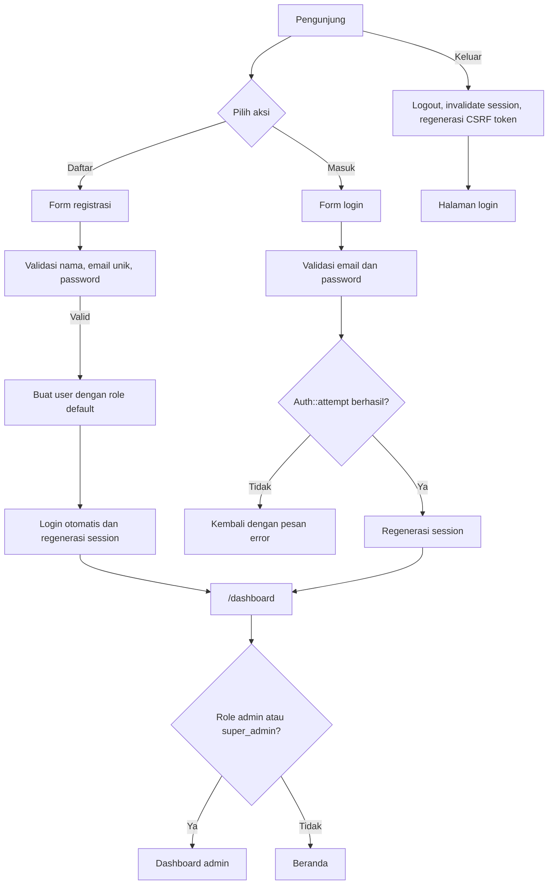

# Panduan Belajar: Autentikasi dan Role

Fitur autentikasi menangani registrasi, login, logout, dan pengalihan pengguna berdasarkan role. Aplikasi menggunakan autentikasi bawaan Laravel melalui session; tidak ada token API pada alur ini.

## 1. Alur Kerja



**Rincian alur:**

- **Registrasi:** form mengirim nama, email, password, dan konfirmasi password dengan metode `POST`. Controller memvalidasi data, menyimpan akun, langsung login, lalu mengarahkan pengguna ke `/dashboard`.
- **Login:** Laravel mencoba mencocokkan email dan password. Jika berhasil, pengguna diarahkan ke URL yang sebelumnya ingin dibuka (jika ada), atau ke `/dashboard`. Jika gagal, pengguna kembali ke form dengan pesan kesalahan dan email tetap terisi.
- **Role:** `/dashboard` mengarahkan `admin` dan `super_admin` ke dashboard admin; role lain (`user`) menuju beranda. Route admin juga dilindungi middleware role.
- **Logout:** form mengirim `POST`; sesi di-logout dan di-invalidasi, lalu token CSRF sesi diperbarui.

## 2. File Terkait

| File | Peran |
|---|---|
| [`AuthController.php`](../../app/Http/Controllers/AuthController.php) | Menampilkan form dan menjalankan registrasi, login, serta logout. |
| [`web.php`](../../routes/web.php) | Mendefinisikan route guest, route logout, redirect `/dashboard` berbasis role, dan grup route admin. |
| [`RoleMiddleware.php`](../../app/Http/Middleware/RoleMiddleware.php) | Memastikan pengguna terautentikasi dan memiliki salah satu role yang diizinkan. |
| [`User.php`](../../app/Models/User.php) | Model autentikasi; menentukan atribut mass-assignable, atribut tersembunyi, dan cast password. |
| [`login.blade.php`](../../resources/views/auth/login.blade.php) | Form login, opsi “ingat saya”, token CSRF, dan tampilan error. |
| [`register.blade.php`](../../resources/views/auth/register.blade.php) | Form registrasi dan konfirmasi password. |
| [`unavbar.blade.php`](../../resources/views/components/unavbar.blade.php) | Menampilkan menu masuk/daftar untuk guest, dan menu pelanggan/keluar untuk pengguna login. |
| [`anavbar.blade.php`](../../resources/views/components/anavbar.blade.php) | Navigasi operasional admin dengan tombol keluar. |
| [`create_users_table`](../../database/migrations/0001_01_01_000000_create_users_table.php) | Membuat kolom role dengan nilai default `user`. |
| [`DatabaseSeeder.php`](../../database/seeders/DatabaseSeeder.php) | Menambahkan akun demo untuk role `super_admin`, `admin`, dan `user`. |

## 3. Bedah Kode Inti

### Registrasi: validasi, simpan, dan login otomatis

Potongan dari `AuthController::register`:

```php
$validate = $request->validate([
    'name' => 'required|string|max:255',
    'email' => 'required|string|email|max:255|unique:users',
    'password' => 'required|string|min:8|confirmed',
]);

$user = User::create([
    'name' => $validate['name'],
    'email' => $validate['email'],
    'password' => Hash::make($validate['password']),
]);
```

`confirmed` mencocokkan `password` dengan `password_confirmation`; `unique:users` menolak email yang sudah terdaftar. Password di-hash sebelum disimpan, dan model `User` juga memiliki cast `hashed`. Role tidak diambil dari input form: karena tidak disertakan saat `User::create`, database menerapkan nilai default `user`. Dengan demikian form registrasi publik tidak menyediakan pilihan untuk mendaftarkan diri sebagai admin.

Setelah pembuatan akun:

```php
Auth::login($user);
$request->session()->regenerate();

return redirect()->route('dashboard');
```

Pengguna langsung masuk setelah registrasi. Regenerasi session mengganti ID sesi setelah status autentikasi berubah.

### Login: percobaan autentikasi dan kegagalan

Potongan dari `AuthController::login`:

```php
$credentials = $request->validate([
    'email' => 'required|email',
    'password' => 'required',
]);

if (Auth::attempt($credentials, $request->boolean('remember'))) {
    $request->session()->regenerate();
    return redirect()->intended(route('dashboard'));
}
```

`Auth::attempt` memeriksa kredensial terhadap akun tersimpan; aplikasi tidak membandingkan password plaintext sendiri. Argumen `remember` membaca checkbox “Ingat saya”. Bila percobaan gagal, controller kembali dengan pesan generik “Email atau password salah” dan hanya mengisi ulang email—pesan tidak membocorkan apakah email atau password yang keliru.

`redirect()->intended(...)` memprioritaskan halaman yang diminta sebelum login. Jika tidak ada halaman tertunda, tujuan default adalah route `dashboard`.

### Role: redirect setelah login dan perlindungan route

Route `/dashboard` memilih tujuan berdasarkan role:

```php
if (in_array(auth()->user()->role, ['admin', 'super_admin'], true)) {
    return redirect()->route('admin.dashboard');
}

return redirect()->route('home');
```

Route tersebut menggunakan middleware `auth`. Selain itu, grup route admin menggunakan `auth` dan `role:admin,super_admin`. Middleware role mengalihkan pengguna yang belum login ke `/login`, lalu memeriksa role secara ketat:

```php
if (!in_array(Auth::user()->role, $roles, true)) {
    abort(403, 'Anda tidak memiliki hak akses ke halaman ini.');
}
```

Karena pengecekan ada pada server dan route, menyembunyikan atau menampilkan tautan navigasi saja bukan mekanisme otorisasi. Pengguna yang sudah login tetapi role-nya tidak diizinkan menerima respons **403**.

### Logout: membersihkan session

Potongan dari `AuthController::logout`:

```php
Auth::logout();
$request->session()->invalidate();
$request->session()->regenerateToken();

return redirect()->route('login');
```

Selain menghapus autentikasi, sesi aktif di-invalidasi dan token CSRF diperbarui. Form logout di navigasi menggunakan `POST` dan menyertakan `@csrf`.

## 4. Poin Pembelajaran

- **Pemisahan route guest dan route auth:** middleware `guest` membatasi halaman login/registrasi untuk pengguna yang belum login; middleware `auth` melindungi dashboard dan fitur akun.
- **Validasi sebelum menulis ke database:** aturan Laravel menangani field wajib, format email, keunikan, panjang password, dan konfirmasi password.
- **Password tidak disimpan sebagai teks biasa:** password di-hash sebelum penyimpanan, dan autentikasi dilakukan melalui Laravel.
- **Session fixation:** session diregenerasi setelah registrasi dan login; logout meng-invalidasi session dan memperbarui CSRF token.
- **Default role lebih aman untuk registrasi publik:** role tidak berasal dari input registrasi dan database menetapkan `user` secara default.
- **Autentikasi berbeda dari otorisasi:** `auth` memastikan pengguna masuk; `RoleMiddleware` memastikan pengguna boleh mengakses fitur admin.
- **Edge case yang ditangani:** email duplikat atau input tidak valid menolak registrasi; kredensial salah mengembalikan error generik; akses admin tanpa role yang sesuai menghasilkan 403; login mempertahankan email saja, bukan password.
