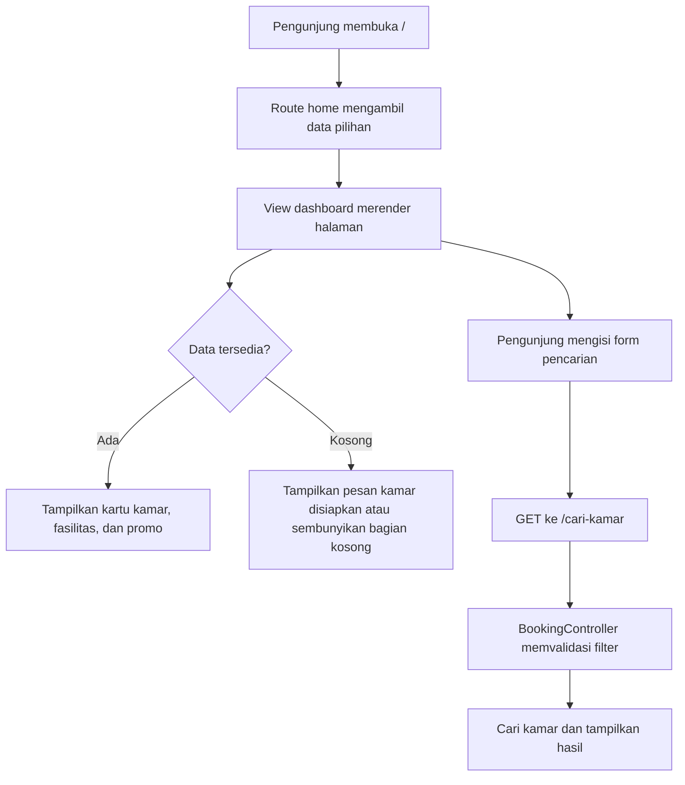

# Panduan Belajar: Beranda

Beranda adalah halaman publik pada route `/`. Route mengambil data pilihan kamar, fasilitas, dan promo dari database, lalu mengirimkannya ke view. Pengunjung juga dapat mulai mencari kamar melalui formulir tanggal menginap dan jumlah tamu.

## 1. Alur Kerja



**Rincian alur:**

- Route `home` memilih maksimal **3 kamar** berstatus `tersedia`, diurutkan dari harga termurah.
- Route memilih maksimal **4 fasilitas aktif**, diurutkan berdasarkan nama, serta maksimal **2 promo aktif** yang paling cepat berakhir.
- View menampilkan kartu jika datanya tersedia. Jika kamar kosong, tampil pesan; bagian promo atau fasilitas tidak ditampilkan bila koleksinya kosong.
- Form pencarian mengirim `check_in`, `check_out`, dan `guests` melalui **GET** ke route `rooms.search`. Endpoint memvalidasi filter dan mengembalikan halaman hasil pencarian, bukan mengubah data.
- Jika tanggal tidak dikirim, hasil pencarian tetap dibatasi ke kamar berstatus tersedia dan sesuai kapasitas. Jika tanggal dikirim, pencarian juga mengecualikan kamar yang sudah memiliki pemesanan bentrok.

## 2. File Terkait

| File | Peran |
|---|---|
| [`web.php`](../../routes/web.php) | Route `home` menyiapkan data beranda; route `rooms.search` meneruskan pencarian ke controller. |
| [`dashboard.blade.php`](../../resources/views/dashboard.blade.php) | View beranda: menampilkan hero, form pencarian, kamar, promo, fasilitas, dan tautan ke fitur lain. |
| [`Kamar.php`](../../app/Models/Kamar.php) | Model kamar; scope `availableBetween` membantu menyaring kamar yang tersedia untuk rentang tanggal. |
| [`Fasilitas.php`](../../app/Models/Fasilitas.php) | Model data fasilitas dan status aktifnya. |
| [`Promo.php`](../../app/Models/Promo.php) | Model promo; scope `active` menyaring promo yang sedang aktif berdasarkan tanggal. |
| [`BookingController.php`](../../app/Http/Controllers/BookingController.php) | Memvalidasi parameter dan menjalankan pencarian yang dikirim dari form beranda. |
| [`search.blade.php`](../../resources/views/booking/search.blade.php) | Menampilkan hasil pencarian kamar. |
| [`unavbar.blade.php`](../../resources/views/components/unavbar.blade.php) | Navigasi publik beranda dan tautan ke pencarian, fasilitas, promo, serta lokasi. |

## 3. Bedah Kode Inti

### Route memilih data unggulan

Potongan dari route `home` di `routes/web.php`:

```php
$featuredRooms = Kamar::query()
    ->where('status', 'tersedia')
    ->orderBy('harga_per_malam')
    ->limit(3)
    ->get();

$activePromos = Promo::query()
    ->active()
    ->orderBy('berakhir_pada')
    ->limit(2)
    ->get();
```

Route menggunakan Eloquent untuk menyiapkan data sebelum view dirender. Daftar fasilitas memakai pola serupa: hanya fasilitas dengan `aktif = true`, diurutkan berdasarkan nama, dan dibatasi empat item. `get()` menghasilkan koleksi; batas jumlah mencegah beranda memuat seluruh inventaris.

### View merender koleksi dan menangani data kosong

Potongan dari `dashboard.blade.php`:

```blade
@forelse ($featuredRooms as $kamar)
    <h3>Kamar {{ $kamar->nomor_kamar }}</h3>
    <span>{{ $kamar->tipe_kamar }}</span>
    <strong>Rp{{ number_format($kamar->harga_per_malam, 0, ',', '.') }}</strong>
@empty
    <p>Kamar sedang disiapkan</p>
@endforelse
```

`@forelse` menampilkan isi koleksi atau fallback bila tidak ada kamar, sehingga halaman tetap punya respons yang jelas pada database baru atau ketika kamar tersedia belum terdaftar. Promo dan fasilitas memakai pemeriksaan `isNotEmpty()`; bagian tersebut disembunyikan saat tidak ada data.

### Form pencarian mengirim filter melalui GET

Potongan ringkas dari formulir beranda:

```blade
<form method="GET" action="{{ route('rooms.search') }}">
    <input type="date" name="check_in" required>
    <input type="date" name="check_out" required>
    <input type="number" name="guests" min="1" max="20" value="{{ request('guests', 1) }}" required>
    <button type="submit">Cari kamar tersedia</button>
</form>
```

GET membuat filter menjadi query string yang dapat dibagikan atau dimuat ulang. Atribut HTML seperti `required`, `min`, dan `max` membantu validasi di browser, tetapi bukan pengganti validasi server.

Pada `BookingController::search`, filter divalidasi kembali:

```php
'check_in' => 'nullable|required_with:check_out|date_format:Y-m-d|after_or_equal:today',
'check_out' => 'nullable|required_with:check_in|date_format:Y-m-d|after:check_in',
'guests' => 'nullable|integer|min:1|max:20',
```

Controller menyediakan default `guests = 1`, mencari kamar yang statusnya tersedia dan kapasitasnya mencukupi, lalu menerapkan `availableBetween` bila kedua tanggal ada. Hasil diurutkan berdasarkan harga dan dipaginasi delapan kamar per halaman.

**Edge case penting:**

- View beranda mewajibkan tanggal lewat atribut `required`, tetapi endpoint pencarian juga dapat dipanggil langsung tanpa tanggal. Karena itu aturan server mengizinkan tanggal kosong selama pasangan tanggal tidak dikirim sebagian.
- Jika hanya satu tanggal dikirim, aturan `required_with` menolak request; check-out harus setelah check-in dan check-in tidak boleh sebelum hari ini.
- Input browser dapat dimanipulasi, sehingga batas tanggal dan jumlah tamu tetap diperiksa di controller.
- Pencarian tanpa tanggal tidak memeriksa bentrok rentang pemesanan; pencarian dengan kedua tanggal menggunakan scope `availableBetween`.

## 4. Poin Pembelajaran

- **Route closure untuk halaman sederhana:** route beranda menjalankan query langsung tanpa controller khusus, lalu memberikan data ke view dengan `compact`.
- **Eloquent query builder:** `where`, `orderBy`, `limit`, dan `get` menyusun query dengan jelas dan membatasi data yang dirender.
- **Scope model untuk logika domain:** filter promo aktif dan ketersediaan berdasarkan tanggal dapat digunakan kembali melalui scope model.
- **Blade untuk conditional rendering:** `@forelse` dan `isNotEmpty()` menangani kondisi data kosong tanpa membuat template terpisah.
- **GET untuk pencarian:** query string cocok untuk filter baca-saja dan membuat pencarian dapat di-bookmark.
- **Validasi dua lapis:** validasi HTML meningkatkan pengalaman pengguna, sedangkan validasi Laravel menjaga integritas request di server.
- **Ketersediaan bersifat kontekstual:** status kamar `tersedia` saja belum cukup untuk tanggal tertentu; pemesanan `pending` atau `confirmed` yang bertumpang tindih juga harus diperhitungkan.
