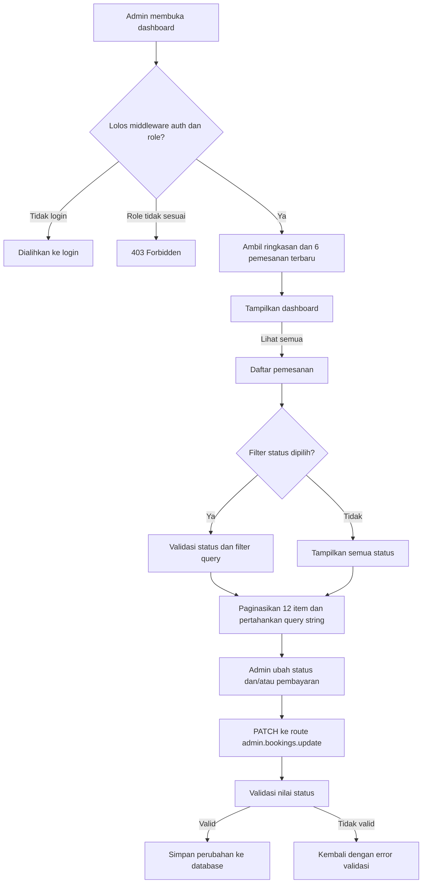

# Panduan Belajar: Dashboard dan Pemesanan Admin

Fitur operasional admin menyediakan ringkasan kamar dan pemesanan terbaru, daftar seluruh pemesanan dengan filter status, serta form untuk memperbarui status pemesanan dan pembayaran. Halaman ini hanya dapat diakses oleh pengguna dengan role `admin` atau `super_admin`.

## 1. Alur Kerja



**Rincian alur:**

- Route admin diberi prefix `/admin` dan dilindungi middleware `auth` serta `role:admin,super_admin`.
- Dashboard menghitung total kamar, kamar tersedia, pemesanan menunggu, dan pemesanan dikonfirmasi; dashboard juga mengambil enam pemesanan terbaru.
- Daftar pemesanan menerima filter `status` opsional. Tanpa filter, semua status ditampilkan; dengan filter, hanya status yang dipilih ditampilkan.
- Form pada setiap baris mengirim `PATCH` berisi status pemesanan dan status pembayaran. Controller memvalidasi lalu menyimpan kedua nilai tersebut.
- Pembayaran dicatat sebagai `pending` atau `paid` untuk konfirmasi manual. Fitur ini tidak memproses transaksi melalui payment gateway.

## 2. File Terkait

| File | Peran |
|---|---|
| [`web.php`](../../routes/web.php) | Mendaftarkan route dashboard, daftar pemesanan, dan update di dalam grup admin yang terlindungi. |
| [`AdminBookingController.php`](../../app/Http/Controllers/AdminBookingController.php) | Menghitung ringkasan, mengambil pemesanan terbaru, memfilter daftar, dan memperbarui status. |
| [`RoleMiddleware.php`](../../app/Http/Middleware/RoleMiddleware.php) | Menolak akses pengguna yang belum login atau role-nya tidak diizinkan. |
| [`Booking.php`](../../app/Models/Booking.php) | Model pemesanan, relasi ke pelanggan dan kamar, serta daftar atribut yang dapat diperbarui. |
| [`Kamar.php`](../../app/Models/Kamar.php) | Model kamar yang dipakai untuk menghitung total dan kamar tersedia. |
| [`dashboard.blade.php`](../../resources/views/admin/dashboard.blade.php) | Menampilkan kartu ringkasan, daftar enam pemesanan terbaru, dan tautan ke operasional. |
| [`index.blade.php`](../../resources/views/admin/bookings/index.blade.php) | Menampilkan filter, tabel pemesanan, form update status, dan navigasi pagination. |
| [`anavbar.blade.php`](../../resources/views/components/anavbar.blade.php) | Navigasi operasional, termasuk tautan ke dashboard dan pemesanan. |

## 3. Bedah Kode Inti

### Proteksi route admin

Potongan dari `routes/web.php`:

```php
Route::middleware(['auth', 'role:admin,super_admin'])
    ->prefix('admin')
    ->name('admin.')
    ->group(function () {
        Route::get('/', [AdminBookingController::class, 'dashboard'])->name('dashboard');
        Route::get('/pemesanan', [AdminBookingController::class, 'index'])->name('bookings.index');
        Route::patch('/pemesanan/{booking}', [AdminBookingController::class, 'update'])->name('bookings.update');
    });
```

`auth` memastikan pengguna sudah login; middleware role membatasi route ke dua role tersebut. Prefix dan nama route memberi alamat `/admin/...` dan nama seperti `admin.bookings.update`, yang dipakai view untuk membangun form.

### Dashboard: ringkasan dan pemesanan terbaru

Potongan dari `AdminBookingController::dashboard`:

```php
$summary = [
    'rooms' => Kamar::count(),
    'available_rooms' => Kamar::where('status', 'tersedia')->count(),
    'pending_bookings' => Booking::where('status', 'pending')->count(),
    'confirmed_bookings' => Booking::where('status', 'confirmed')->count(),
];

$recentBookings = Booking::query()
    ->with(['user', 'kamar'])
    ->latest()
    ->limit(6)
    ->get();
```

Kartu ringkasan memakai hitungan terpisah dari tabel kamar dan pemesanan. `with(['user', 'kamar'])` memuat relasi yang dibaca di view bersama query pemesanan, sehingga menghindari query tambahan untuk setiap baris. Jika belum ada pemesanan, view menggunakan `@forelse` untuk menampilkan pesan kosong.

### Daftar: filter tervalidasi dan pagination

Potongan dari `AdminBookingController::index`:

```php
$filters = $request->validate([
    'status' => 'nullable|in:pending,confirmed,completed,cancelled',
]);

$bookings = Booking::query()
    ->with(['user', 'kamar'])
    ->when($filters['status'] ?? null, fn ($query, $status) => $query->where('status', $status))
    ->latest()
    ->paginate(12)
    ->withQueryString();
```

Hanya empat nilai status yang diterima; nilai di luar daftar gagal validasi, tidak digunakan sebagai filter bebas. `when` menambahkan kondisi hanya bila filter diberikan. `withQueryString()` mempertahankan filter saat admin berpindah halaman pagination.

### Update: validasi sebelum menyimpan

Form pada view memakai `POST` dengan spoofing method `PATCH`, token CSRF, dan dua pilihan status. Potongan dari `AdminBookingController::update`:

```php
$data = $request->validate([
    'status' => 'required|in:pending,confirmed,completed,cancelled',
    'payment_status' => 'required|in:pending,paid',
]);

$booking->update($data);
```

Parameter `{booking}` memakai route model binding untuk menemukan data pemesanan. Model `Booking` mengizinkan `status` dan `payment_status` melalui `$fillable`, sehingga kedua nilai hasil validasi dapat di-update secara mass assignment.

**Edge case dan batasan:**

- Filter status yang tidak dikenal dan nilai update yang tidak diizinkan ditolak oleh validasi Laravel; input tidak langsung disimpan.
- Jika ID pemesanan di URL tidak ditemukan, route model binding menghasilkan 404.
- Controller memvalidasi himpunan nilai, tetapi tidak menetapkan aturan transisi status. Contohnya, ia tidak melarang perubahan dari `completed` kembali ke `pending`; nilai yang diizinkan tetap dapat dipilih admin.
- Dashboard menampilkan data kosong dengan pesan khusus pada daftar pemesanan terbaru. Halaman daftar juga menyediakan pesan saat hasil filter tidak memiliki data.
- Pembaruan status pembayaran hanya mencatat nilai `pending` atau `paid`; tidak ada verifikasi otomatis dari penyedia pembayaran.

## 4. Poin Pembelajaran

- **Otorisasi pada server:** menu navigasi bukan batas keamanan; grup route dilindungi middleware autentikasi dan role.
- **Agregasi sederhana dengan Eloquent:** `count()` menyediakan angka ringkasan tanpa memuat seluruh baris ke aplikasi.
- **Eager loading:** `with()` memuat relasi pelanggan dan kamar yang digunakan pada daftar, mengurangi pola query N+1.
- **Filter opsional yang aman:** validasi `in` membatasi nilai filter/status ke pilihan yang ditentukan aplikasi.
- **Pagination dan query string:** membatasi ukuran halaman sekaligus mempertahankan filter saat berpindah halaman.
- **Mass assignment terkontrol:** request divalidasi terlebih dahulu dan hanya field status yang diizinkan diteruskan ke `update`.
- **Validasi nilai bukan aturan transisi:** daftar status valid tidak otomatis menjamin urutan perubahan status bisnis; aturan transisi khusus perlu dibuat tersendiri bila diperlukan.
- **Status pembayaran bukan payment gateway:** status `paid` adalah data yang diperbarui admin, bukan hasil callback atau verifikasi transaksi otomatis.
