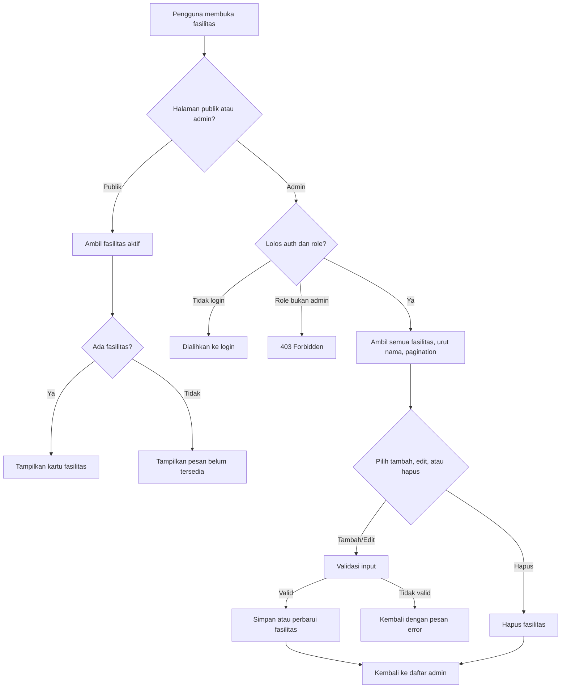

# Panduan Belajar: Fasilitas Hotel

Fitur fasilitas memiliki dua sisi: pengunjung melihat fasilitas yang aktif, sedangkan admin dapat melihat semua data dan menambah, mengubah, atau menghapus fasilitas. Data fasilitas terdiri dari nama, kode ikon singkat, deskripsi, dan penanda aktif.

## 1. Alur Kerja



**Rincian alur:**

- Halaman publik mengambil hanya data `aktif = true` dan mengurutkannya berdasarkan nama. Jika kosong, view menampilkan pesan fallback.
- Daftar admin menampilkan fasilitas aktif maupun nonaktif, 12 item per halaman; status nonaktif ditandai “Disembunyikan”.
- Form admin dipakai untuk membuat dan mengedit. Controller memvalidasi data sebelum operasi database.
- Penghapusan dilakukan melalui form `DELETE` dengan token CSRF. Semua route admin berada di balik middleware autentikasi dan role `admin`/`super_admin`.

## 2. File Terkait

| File | Peran |
|---|---|
| [`web.php`](../../routes/web.php) | Mendaftarkan halaman publik dan route resource fasilitas admin di dalam grup yang dilindungi. |
| [`FasilitasController.php`](../../app/Http/Controllers/FasilitasController.php) | Mengambil fasilitas untuk publik/admin dan menangani operasi create, update, serta delete. |
| [`Fasilitas.php`](../../app/Models/Fasilitas.php) | Menentukan tabel, atribut yang dapat diisi, dan cast boolean untuk `aktif`. |
| [`RoleMiddleware.php`](../../app/Http/Middleware/RoleMiddleware.php) | Membatasi akses route admin untuk role yang diperbolehkan. |
| [`index.blade.php` publik](../../resources/views/fasilitas/index.blade.php) | Menampilkan fasilitas aktif atau pesan jika data belum tersedia. |
| [`index.blade.php` admin](../../resources/views/admin/fasilitas/index.blade.php) | Menampilkan seluruh fasilitas, statusnya, tombol edit/hapus, dan pagination. |
| [`form.blade.php`](../../resources/views/admin/fasilitas/form.blade.php) | Form tambah/edit dengan input nama, ikon, deskripsi, dan status aktif. |
| [`anavbar.blade.php`](../../resources/views/components/anavbar.blade.php) | Navigasi operasional admin. |
| [`create_fasilitas_table`](../../database/migrations/2026_11_27_100000_create_fasilitas_table.php) | Membuat tabel fasilitas; kolom `aktif` bertipe boolean dan default-nya `true`. |

## 3. Bedah Kode Inti

### Tampilan publik hanya mengambil fasilitas aktif

Potongan dari `FasilitasController::index`:

```php
$fasilitas = Fasilitas::query()
    ->where('aktif', true)
    ->orderBy('nama')
    ->get();

return view('fasilitas.index', compact('fasilitas'));
```

Filter aktif diterapkan di query server, bukan hanya dengan menyembunyikan elemen di view. Akibatnya fasilitas nonaktif tidak ikut dikirim ke halaman publik. View memakai `@forelse` untuk menampilkan kartu fasilitas atau pesan saat koleksi kosong.

### Daftar admin memasukkan item nonaktif

Potongan dari `FasilitasController::adminIndex`:

```php
$fasilitas = Fasilitas::query()
    ->orderBy('nama')
    ->paginate(12);
```

Karena tidak ada filter `aktif`, admin tetap dapat melihat item yang disembunyikan dan mengaktifkannya kembali lewat form edit. Pagination menjaga jumlah data per halaman tetap terbatas.

### Validasi dan penyimpanan

Aturan yang digunakan Controller untuk operasi create/update:

```php
'nama' => 'required|string|max:100',
'ikon' => 'required|string|max:20',
'deskripsi' => 'required|string|max:1000',
'aktif' => 'required|boolean',
```

Setelah lolos validasi, create menggunakan `Fasilitas::create($data)` dan update menggunakan `$fasilitas->update($data)`. Model mengizinkan empat atribut tersebut melalui `$fillable`; cast `aktif` sebagai boolean membuat nilainya dibaca sebagai boolean oleh model.

Pada form, checkbox status dilengkapi input tersembunyi:

```blade
<input type="hidden" name="aktif" value="0">
<input type="checkbox" id="aktif" name="aktif" value="1"
    @checked(old('aktif', $fasilitas->aktif ?? true))>
```

Input tersembunyi mengirim nilai `0` saat checkbox tidak dicentang, sehingga field `aktif` tetap dikirim dan memenuhi aturan `required`. Saat dicentang, nilai `1` digunakan. Pada form tambah, nilai awalnya aktif; saat validasi gagal, `old()` mempertahankan pilihan sebelumnya.

### Route resource dan otorisasi

Route admin menggabungkan route daftar yang ditangani `adminIndex()` dengan route resource untuk operasi lainnya:

```php
Route::get('/fasilitas', [FasilitasController::class, 'adminIndex'])->name('fasilitas.index');
Route::resource('fasilitas', FasilitasController::class)
    ->except(['index', 'show'])
    ->parameters(['fasilitas' => 'fasilitas']);
```

Route tersebut berada di dalam grup `auth` dan `role:admin,super_admin`. Karena `index` dan `show` dikecualikan dari resource, halaman daftar memakai route eksplisit di atas dan tidak ada halaman detail admin khusus.

**Edge case dan batasan:**

- Jika tidak ada fasilitas aktif, halaman publik menampilkan pesan; jika daftar admin kosong, admin melihat pesan belum ada data.
- Nama, ikon, dan deskripsi wajib diisi; nilai melebihi batas panjang atau nilai `aktif` yang bukan boolean ditolak validasi.
- Jika checkbox status tidak dicentang, nilai tersembunyi `0` memungkinkan fasilitas disimpan sebagai nonaktif, bukan kehilangan field.
- Route model binding pada edit/update/delete mengembalikan 404 jika ID fasilitas tidak ditemukan.
- Route admin tidak dapat diakses guest atau pengguna dengan role selain admin/super admin.

## 4. Poin Pembelajaran

- **Pisahkan kebutuhan publik dan admin:** query publik menyaring data aktif, sedangkan admin perlu melihat seluruh data untuk mengelolanya.
- **Validasi server-side:** batas panjang dan kewajiban input harus ditegakkan di Controller, bukan hanya atribut HTML.
- **Mass assignment dengan `$fillable`:** model membatasi field yang dapat diisi melalui `create` dan `update`.
- **Cast tipe data:** cast boolean menjaga kolom status digunakan secara konsisten sebagai nilai boolean di PHP.
- **Checkbox HTML dan nilai kosong:** checkbox yang tidak dicentang tidak dikirim browser; hidden input menyediakan nilai eksplisit untuk kondisi tersebut.
- **Route resource:** Laravel menyediakan pola route CRUD yang konsisten; `except` dapat meniadakan aksi yang tidak dipakai.
- **Otorisasi pada route:** proteksi akses dilakukan di server melalui middleware, bukan hanya dengan menyembunyikan tombol admin.
- **Blade empty state:** `@forelse` membuat halaman tetap informatif ketika belum ada data untuk ditampilkan.
