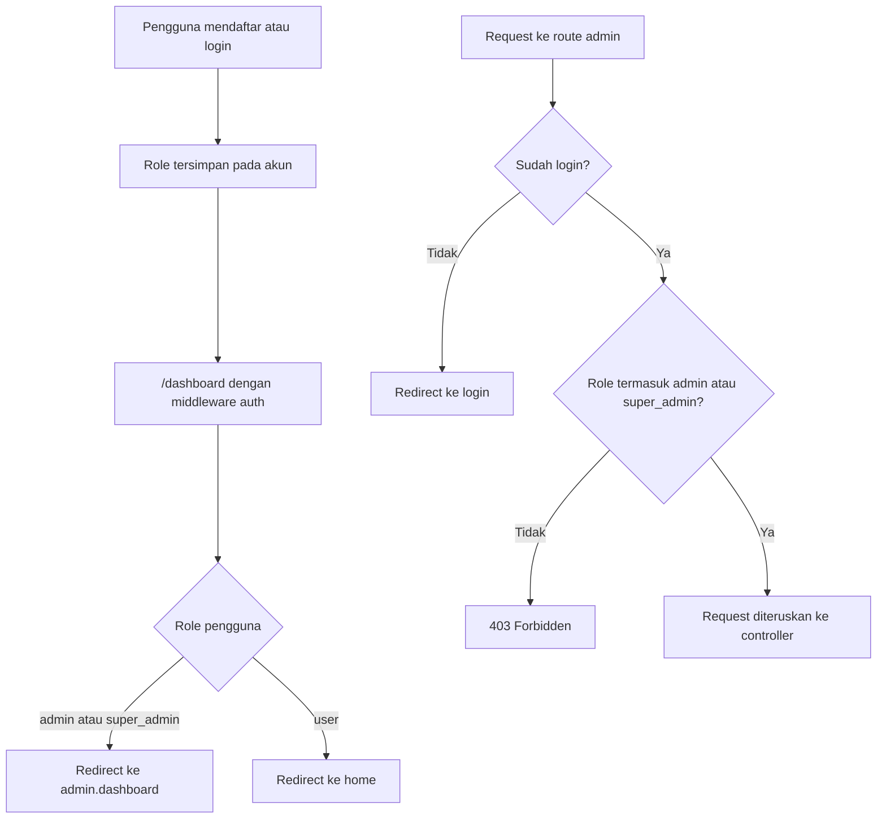

# Panduan Belajar: Hak Akses Berdasarkan Role

Aplikasi membedakan pengguna dengan role `user`, `admin`, dan `super_admin`. Autentikasi memastikan pengguna sudah masuk; middleware role kemudian membatasi route operasional admin. Role juga dipakai untuk menentukan tujuan route `/dashboard` dan tautan navigasi yang ditampilkan.

## 1. Alur Kerja



**Rincian alur:**

- Kolom role pada tabel `users` hanya menerima `super_admin`, `admin`, atau `user`, dan default-nya `user`.
- Registrasi publik tidak menerima role dari form. Controller hanya mengirim nama, email, dan password saat membuat akun, sehingga akun baru mendapat nilai default `user`.
- Setelah login, `/dashboard` mengarahkan `admin` dan `super_admin` ke dashboard admin; role lain diarahkan ke beranda.
- Route operasional kamar, pemesanan admin, fasilitas admin, dan promo admin dilindungi `auth` serta `role:admin,super_admin`.
- Pengguna yang login tetapi tidak memiliki role yang diizinkan mendapat 403. Guest dialihkan ke halaman login.
- Navigasi menyesuaikan status login dan role, tetapi keputusan akses sebenarnya tetap dilakukan di server melalui middleware.

## 2. File Terkait

| File | Peran |
|---|---|
| [`web.php`](../../routes/web.php) | Mengatur middleware route, grup route admin, dan pengalihan `/dashboard` berdasarkan role. |
| [`RoleMiddleware.php`](../../app/Http/Middleware/RoleMiddleware.php) | Memastikan autentikasi dan memeriksa apakah role akun ada dalam daftar yang diizinkan. |
| [`User.php`](../../app/Models/User.php) | Model akun; memuat atribut `role` sebagai mass-assignable dan mewarisi autentikasi Laravel. |
| [`AuthController.php`](../../app/Http/Controllers/AuthController.php) | Membuat akun baru tanpa mengambil role dari input registrasi, serta menjalankan login/logout. |
| [`create_users_table`](../../database/migrations/0001_01_01_000000_create_users_table.php) | Mendefinisikan pilihan role pada kolom `users.role` dan default `user`. |
| [`DatabaseSeeder.php`](../../database/seeders/DatabaseSeeder.php) | Membuat akun demo untuk setiap role. |
| [`unavbar.blade.php`](../../resources/views/components/unavbar.blade.php) | Menampilkan menu akun dan tautan Operasional untuk admin/super admin yang login. |
| [`anavbar.blade.php`](../../resources/views/components/anavbar.blade.php) | Menyediakan navigasi area admin; halaman yang menggunakannya tetap dilindungi route middleware. |

## 3. Bedah Kode Inti

### Nilai role pada database

Potongan dari migration tabel users:

```php
$table->enum('role', ['super_admin', 'admin', 'user'])->default('user');
```

Database membatasi role ke tiga nilai tersebut. Default `user` membuat akun yang dibuat tanpa nilai role menjadi akun pelanggan biasa. Pada registrasi, `AuthController` hanya mengirim `name`, `email`, dan `password` ke `User::create`; nilai `role` tidak diambil dari request.

### Pengalihan dashboard

Potongan route `/dashboard` di `routes/web.php`:

```php
Route::get('/dashboard', function () {
    if (in_array(auth()->user()->role, ['admin', 'super_admin'], true)) {
        return redirect()->route('admin.dashboard');
    }

    return redirect()->route('home');
})->middleware('auth')->name('dashboard');
```

Middleware `auth` memastikan `auth()->user()` tersedia. Perbandingan ketat pada `in_array(..., true)` memastikan pemeriksaan role tidak memakai konversi tipe. Di aplikasi ini role `admin` dan `super_admin` menerima tujuan dashboard yang sama.

### Proteksi route admin

Contoh grup route operasional:

```php
Route::middleware(['auth', 'role:admin,super_admin'])
    ->prefix('admin')
    ->name('admin.')
    ->group(function () {
        Route::get('/', [AdminBookingController::class, 'dashboard'])->name('dashboard');
        // Route pengelolaan pemesanan, fasilitas, dan promo berada di grup ini.
    });
```

Grup lain juga menerapkan middleware yang sama pada resource kamar. Middleware khusus menerima daftar role yang diteruskan dari deklarasi route:

```php
if (!Auth::check()) {
    return redirect('/login');
}

if (!in_array(Auth::user()->role, $roles, true)) {
    abort(403, 'Anda tidak memiliki hak akses ke halaman ini.');
}

return $next($request);
```

Jika pengguna tidak login, request diarahkan ke login. Jika login tetapi tidak memiliki role yang cocok, request dihentikan dengan 403. Hanya request yang lolos kedua pemeriksaan diteruskan ke controller.

### Navigasi bukan pengganti otorisasi

Di navigasi publik, tautan Operasional hanya dirender untuk role admin:

```blade
@if (in_array(auth()->user()->role, ['admin', 'super_admin'], true))
    <a href="{{ route('admin.dashboard') }}">Operasional</a>
@endif
```

Pengecekan ini memperbaiki pengalaman pengguna dengan menyembunyikan tautan yang tidak relevan. Namun, pengguna tetap dapat mencoba membuka URL secara langsung, sehingga middleware route tetap diperlukan sebagai kontrol akses server.

**Edge case dan batasan:**

- Akun yang baru mendaftar tidak dapat memilih role admin dari form; nilainya mengikuti default database `user`.
- Role yang tidak terdaftar ditolak oleh tipe kolom enum di database. Jika role valid tetapi tidak termasuk daftar route, middleware mengembalikan 403.
- Route admin yang dikunjungi guest mengarahkan pengguna ke login; autentikasi saja belum cukup bila role-nya bukan `admin` atau `super_admin`.
- Tidak ada perbedaan hak admin dan super admin pada middleware yang ditinjau: keduanya diterima pada grup route admin yang sama.
- Kode yang ditinjau menyediakan akun demo melalui seeder, tetapi tidak menunjukkan halaman khusus untuk mengelola atau mengubah role pengguna.

## 4. Poin Pembelajaran

- **Authentication vs authorization:** `auth` menjawab “siapa yang login?”, sedangkan middleware role menjawab “apakah akun ini boleh mengakses route?”.
- **Default role dengan least privilege:** akun registrasi baru mendapat role `user`, bukan hak istimewa.
- **Pertahanan di sisi server:** menyembunyikan tautan di Blade bukan pengamanan; akses harus diperiksa pada route/middleware.
- **Middleware yang dapat menerima parameter:** deklarasi `role:admin,super_admin` memberikan daftar role yang dibandingkan di middleware.
- **Perbandingan ketat:** `in_array(..., true)` mencegah kecocokan berdasarkan konversi tipe.
- **Pembatasan nilai di database:** enum memastikan role yang tersimpan termasuk pilihan yang didefinisikan.
- **Pengalaman pengguna setelah login:** route dashboard mengarahkan role yang berbeda ke area yang sesuai, tetapi otorisasi tiap fitur tetap perlu diterapkan pada route.
