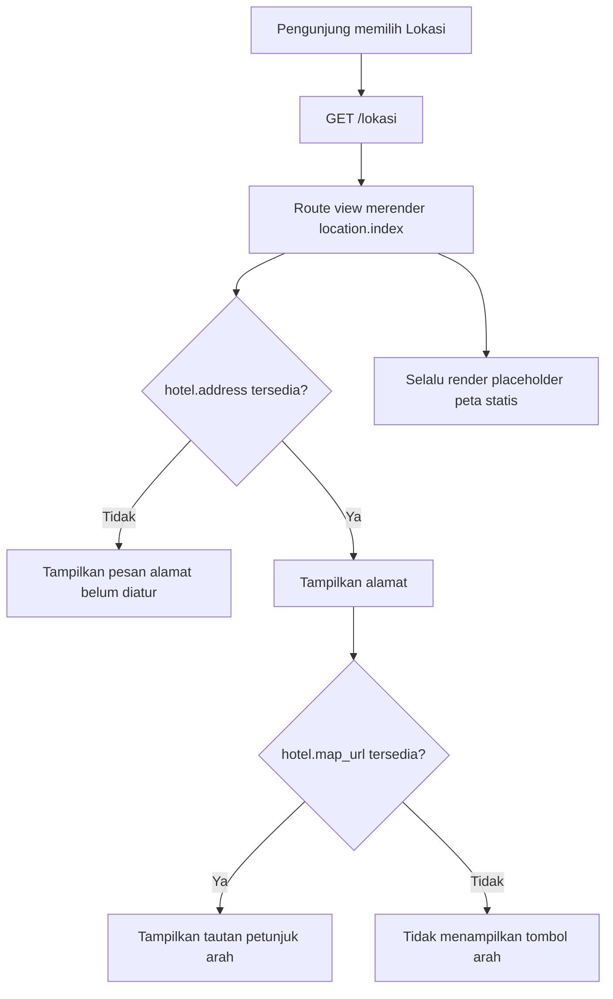

# Panduan Belajar: Lokasi Hotel

Halaman lokasi adalah halaman publik yang menampilkan alamat hotel dan, bila dikonfigurasi, tombol untuk membuka petunjuk arah. Data alamat dan URL peta berasal dari environment config; fitur ini tidak membaca data lokasi dari database.

## 1. Alur Kerja



**Rincian alur:**

- Tautan Lokasi di navigasi publik mengarah ke route bernama `location.show` (`/lokasi`).
- Route menggunakan `Route::view`, jadi view dirender langsung tanpa controller khusus.
- `config/hotel.php` membaca `HOTEL_ADDRESS` dan `HOTEL_MAP_URL` dari environment.
- Alamat ditampilkan jika `hotel.address` berisi nilai. Tombol petunjuk arah hanya ditampilkan jika alamat dan `hotel.map_url` sama-sama tersedia.
- Tidak ada model atau query database untuk halaman ini.

## 2. File Terkait

| File | Peran |
|---|---|
| [`web.php`](../../routes/web.php) | Mendaftarkan route publik `/lokasi` bernama `location.show` yang langsung merender view. |
| [`index.blade.php`](../../resources/views/location/index.blade.php) | Menampilkan informasi alamat, kondisi fallback, tombol petunjuk arah, dan placeholder peta. |
| [`hotel.php`](../../config/hotel.php) | Memetakan environment `HOTEL_ADDRESS` dan `HOTEL_MAP_URL` ke konfigurasi aplikasi. |
| [`.env.example`](../../.env.example) | Menyediakan nama variabel environment lokasi sebagai contoh konfigurasi. |
| [`unavbar.blade.php`](../../resources/views/components/unavbar.blade.php) | Menyediakan tautan navigasi publik ke halaman lokasi. |

**Controller/Model:** tidak ada controller maupun model khusus; route dan view menangani halaman ini, dengan konfigurasi sebagai sumber datanya.

## 3. Bedah Kode Inti

### Route langsung ke view

Potongan dari `routes/web.php`:

```php
Route::view('/lokasi', 'location.index')->name('location.show');
```

`Route::view` cocok untuk halaman baca-saja yang tidak perlu menyiapkan data melalui controller. Route ini bersifat publik dan tidak dimasukkan ke grup middleware `auth`.

### Environment menjadi konfigurasi aplikasi

Isi `config/hotel.php`:

```php
return [
    'address' => env('HOTEL_ADDRESS'),
    'map_url' => env('HOTEL_MAP_URL'),
];
```

View membaca konfigurasi lewat `config('hotel.address')` dan `config('hotel.map_url')`, bukan membaca `env()` secara langsung. Isi nilainya di `.env` lokal:

```dotenv
HOTEL_ADDRESS="Alamat hotel Anda"
HOTEL_MAP_URL="https://maps.google.com/?q=..."
```

### Kondisi tampilan alamat dan tautan

Potongan dari `location/index.blade.php`:

```blade
@if (config('hotel.address'))
    <p>{{ config('hotel.address') }}</p>
    @if (config('hotel.map_url'))
        <a href="{{ config('hotel.map_url') }}" target="_blank" rel="noopener noreferrer">
            Buka petunjuk arah
        </a>
    @endif
@else
    <p>Pengelola belum mengatur alamat untuk ditampilkan.</p>
@endif
```

Kondisi URL peta berada di dalam kondisi alamat. Artinya URL peta saja tidak cukup untuk menampilkan tombol: alamat juga harus terisi. Tautan dibuka di tab baru dengan `rel="noopener noreferrer"`.

**Edge case dan batasan:**

- Jika alamat kosong, halaman menampilkan keterangan bahwa alamat belum diatur dan tombol petunjuk arah tidak ditampilkan.
- Jika alamat tersedia tetapi URL peta kosong, alamat tetap tampil tanpa tombol.
- Jika URL peta tersedia tetapi alamat kosong, cabang fallback alamat aktif dan URL peta tidak digunakan.
- Placeholder di kolom peta saat ini selalu berupa tampilan statis dengan teks “Alamat hotel belum dikonfigurasi.” Teks ini tidak mengikuti nilai `HOTEL_ADDRESS`; karena itu masih terlihat walaupun alamat di panel informasi sudah ditampilkan.
- URL peta ditampilkan sebagai `href` tanpa validasi format di fitur ini. Pastikan nilai environment adalah URL tujuan yang tepercaya dan benar.
- Halaman ini tidak menyematkan peta interaktif; tautan eksternal merupakan satu-satunya navigasi petunjuk arah.

## 4. Poin Pembelajaran

- **Route view untuk halaman sederhana:** route dapat langsung merender Blade ketika tidak ada logika controller atau query yang diperlukan.
- **Konfigurasi per lingkungan:** alamat dan URL dapat berbeda antara pengembangan dan produksi tanpa mengubah kode view.
- **Gunakan `config()` di aplikasi:** nilai yang sudah dipetakan ke file konfigurasi diakses melalui helper `config`.
- **Conditional rendering Blade:** `@if` dapat membentuk fallback dan menampilkan elemen secara bertingkat sesuai ketersediaan data.
- **Pahami dependensi kondisi:** tombol petunjuk arah mensyaratkan alamat lebih dulu karena pemeriksaan URL berada di dalam cabang alamat.
- **Buka tautan eksternal dengan aman:** `target="_blank"` dipasangkan dengan `rel="noopener noreferrer"`.
- **Bedakan placeholder dengan data dinamis:** elemen peta saat ini statis, sehingga teksnya tidak mencerminkan konfigurasi alamat.
