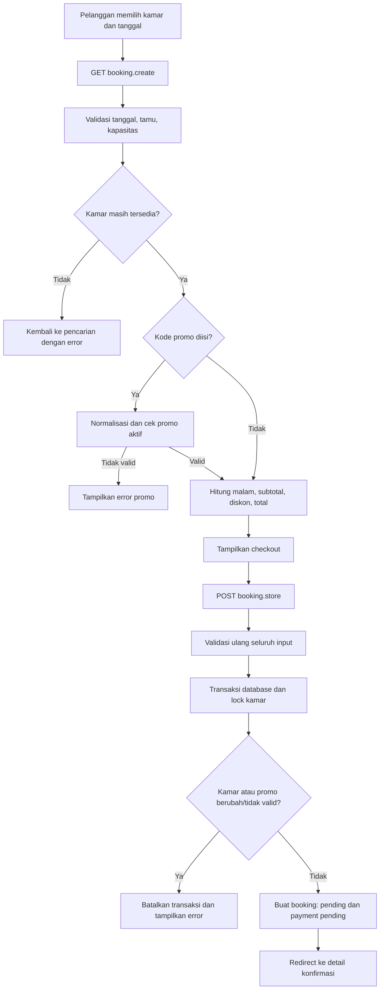

# Panduan Belajar: Pemesanan Kamar

Fitur pemesanan memungkinkan pelanggan yang sudah login mengirim permintaan reservasi. Sistem memvalidasi tanggal, kapasitas, metode pembayaran, dan promo; mengecek ketersediaan lagi saat submit; menghitung total di server; lalu menyimpan pemesanan dengan status menunggu.

## 1. Alur Kerja



**Rincian alur:**

- Pencarian/detail kamar bersifat publik, tetapi route checkout dan penyimpanan pemesanan menggunakan middleware `auth`.
- Halaman checkout (`create`) menerima tanggal, `guests`, dan kode promo melalui query string. Controller memvalidasi data, memeriksa ketersediaan dan menghitung estimasi biaya untuk ditampilkan.
- Form konfirmasi mengirim `POST` dengan `guest_count`, metode pembayaran, permintaan khusus, serta tanggal dan kode promo tersembunyi.
- Saat menerima `POST`, server memvalidasi ulang input dan menghitung ulang harga/diskon. Nilai total dari browser tidak dipercaya.
- Pembuatan booking terjadi dalam transaksi. Baris kamar dikunci sementara, ketersediaan dan promo diperiksa lagi, baru booking disimpan.
- Booking baru selalu dimulai dengan status pemesanan `pending` dan status pembayaran `pending`. Pembayaran masih dikonfirmasi secara manual, tanpa payment gateway.

## 2. File Terkait

| File | Peran |
|---|---|
| [`web.php`](../../routes/web.php) | Mendaftarkan halaman kamar publik serta route checkout, simpan, dan detail booking yang memerlukan login. |
| [`BookingController.php`](../../app/Http/Controllers/BookingController.php) | Memvalidasi parameter, mengecek ketersediaan, menghitung biaya, menyimpan booking secara transaksional, dan menampilkan konfirmasi. |
| [`Booking.php`](../../app/Models/Booking.php) | Model booking, field yang dapat disimpan, cast tanggal/biaya, dan relasi ke user, kamar, serta promo. |
| [`Kamar.php`](../../app/Models/Kamar.php) | Relasi booking dan scope `availableBetween` untuk mengecualikan kamar yang sudah terpesan pada rentang tanggal. |
| [`Promo.php`](../../app/Models/Promo.php) | Menentukan promo aktif dan menghitung nilai diskon persentase. |
| [`create.blade.php`](../../resources/views/booking/create.blade.php) | Form checkout, pilihan pembayaran, kode promo, dan ringkasan biaya. |
| [`show.blade.php`](../../resources/views/booking/show.blade.php) | Menampilkan kode booking, status, rincian kamar/tanggal, biaya, dan instruksi pembayaran. |
| [`search.blade.php`](../../resources/views/booking/search.blade.php) | Halaman hasil pencarian sebelum pelanggan memilih kamar. |
| [`room.blade.php`](../../resources/views/booking/room.blade.php) | Detail kamar dan titik masuk menuju checkout. |
| [`create_bookings_table`](../../database/migrations/2026_11_27_110000_create_bookings_table.php) | Membuat tabel booking, foreign key, kode unik, tanggal, biaya, metode, dan status. |
| [`add_promo_to_bookings_table`](../../database/migrations/2026_11_27_120000_add_promo_to_bookings_table.php) | Menambahkan relasi promo, salinan kode promo, dan nilai diskon pada booking. |

## 3. Bedah Kode Inti

### Route checkout memerlukan login

Potongan dari `routes/web.php`:

```php
Route::middleware('auth')->group(function () {
    Route::get('/kamar/{kamar}/pesan', [BookingController::class, 'create'])->name('booking.create');
    Route::post('/kamar/{kamar}/pesan', [BookingController::class, 'store'])->name('booking.store');
});
```

Route pencarian dan detail kamar berada di luar grup autentikasi, sehingga dapat dilihat pengunjung. Membuat dan menyimpan pemesanan hanya tersedia untuk pengguna login. Parameter `{kamar}` menggunakan route model binding.

### Validasi dan pengecekan awal saat menampilkan checkout

`BookingController::create` mewajibkan tanggal check-in hari ini atau sesudahnya, check-out setelah check-in, dan jumlah tamu tidak melebihi kapasitas kamar. Kemudian ia memanggil `availableBetween` untuk menolak kamar yang sudah tidak tersedia. Pemeriksaan ini membuat pengalaman checkout lebih baik, tetapi bukan satu-satunya pengaman karena status dapat berubah sebelum form dikirim.

### Cek ulang ketersediaan dalam transaksi

Potongan penting dari `BookingController::store`:

```php
$booking = DB::transaction(function () use ($data, $kamar, $request) {
    $lockedKamar = Kamar::query()
        ->lockForUpdate()
        ->findOrFail($kamar->getKey());

    $overlappingBooking = $lockedKamar->bookings()
        ->whereIn('status', ['pending', 'confirmed'])
        ->whereDate('check_in', '<', $data['check_out'])
        ->whereDate('check_out', '>', $data['check_in'])
        ->exists();
```

Transaksi mengunci baris kamar, lalu mencari booking `pending` atau `confirmed` yang tanggalnya tumpang tindih. Syarat `< check_out` dan `> check_in` memakai rentang checkout eksklusif: booking yang check-out tepat pada tanggal check-in booking berikutnya tidak dianggap bentrok. Jika kamar tidak tersedia, kapasitas sudah berubah, atau rentang bertabrakan, controller melempar `ValidationException` sehingga transaksi tidak membuat booking.

### Hitung diskon dan simpan data dari server

Potongan dari bagian pembuatan booking:

```php
$subtotal = (float) $lockedKamar->harga_per_malam * $nights;
$discountAmount = $promo?->discountFor($subtotal) ?? 0;

return Booking::create([
    'booking_code' => 'UHS-'.now()->format('ymd').'-'.Str::upper(Str::random(6)),
    'user_id' => $request->user()->id,
    'kamar_id' => $lockedKamar->id,
    'promo_id' => $promo?->id,
    'total_amount' => $subtotal - $discountAmount,
    'discount_amount' => $discountAmount,
    'payment_method' => $data['payment_method'],
    'status' => 'pending',
    'payment_status' => 'pending',
]);
```

Total dihitung menggunakan harga kamar terbaru dan diskon dari model `Promo`, bukan angka yang dikirim browser. Identitas user diambil dari sesi autentikasi, bukan dari field form. Kode booking dibentuk server dan memiliki constraint unik di database. Model `Booking` mengizinkan field-field ini melalui `$fillable`.

Validasi POST juga membatasi `payment_method` ke `bank_transfer` atau `pay_at_hotel`; `special_request` opsional dengan panjang maksimal 500 karakter. Kode promo dinormalisasi menjadi huruf kapital dan dicek kembali dalam transaksi agar promo yang sudah tidak aktif tidak dipakai.

**Edge case dan batasan:**

- Tanggal tidak valid, check-out sebelum/bersamaan check-in, jumlah tamu di luar kapasitas, metode pembayaran tak dikenal, atau permintaan khusus terlalu panjang ditolak validasi.
- Kamar mungkin dipesan setelah halaman checkout dibuka. Karena itu controller melakukan pemeriksaan ulang saat POST; jika bentrok, booking tidak disimpan.
- Promo kosong berarti tidak ada diskon. Promo yang tidak ditemukan atau sudah tidak aktif menghasilkan error validasi; jika promo berubah setelah checkout ditampilkan, kode diperiksa ulang saat POST.
- Pembatalan pembayaran dan verifikasi transfer bukan proses otomatis pada fitur ini. Status awal pembayaran `pending`, dan staf mengonfirmasinya secara manual.
- Kode booking acak dilindungi constraint unik. Jika terjadi collision yang sangat jarang, database menolak insert; controller tidak memiliki mekanisme retry khusus untuk collision tersebut.

## 4. Poin Pembelajaran

- **Validasi ulang di server:** nilai dari form dan halaman sebelumnya dapat berubah atau dimanipulasi; server memvalidasi ulang saat operasi tulis.
- **Jangan percaya total dari browser:** harga, jumlah malam, diskon, dan total dihitung ulang dari data database.
- **Transaksi dan row lock:** transaksi menggabungkan pemeriksaan ketersediaan dengan insert; `lockForUpdate` membantu mencegah dua request memesan kamar yang sama bersamaan.
- **Rentang tanggal menginap:** pola overlap menganggap check-out sebagai batas eksklusif, sehingga tamu berikutnya dapat check-in pada tanggal checkout sebelumnya.
- **Relasi Eloquent:** booking menghubungkan pelanggan, kamar, dan promo melalui foreign key dan relasi model.
- **Mass assignment:** `$fillable` menentukan field yang dapat dipersistenkan lewat `Booking::create`.
- **Sumber identitas tepercaya:** `user_id` berasal dari pengguna yang terautentikasi, bukan dari request klien.
- **Status operasional terpisah:** status booking dan status pembayaran adalah dua atribut berbeda; pemilihan metode pembayaran belum berarti pembayaran sudah terverifikasi.
