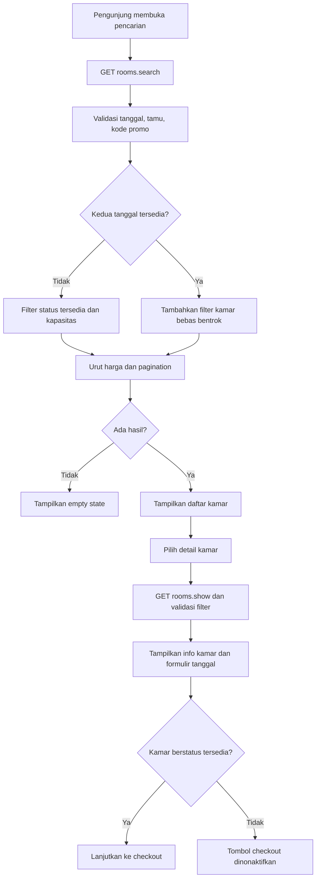

# Panduan Belajar: Pencarian dan Detail Kamar

Fitur ini memungkinkan pengunjung mencari kamar dengan filter kapasitas dan tanggal, melihat hasil yang diurutkan berdasarkan harga, lalu membuka detail kamar. Pencarian dan detail bersifat publik; proses checkout berikutnya memerlukan login.

## 1. Alur Kerja



**Rincian alur:**

- `rooms.search` menerima query string opsional `check_in`, `check_out`, `guests`, dan `promo_code`.
- Hasil awal selalu difilter ke kamar berstatus `tersedia` dan kapasitas cukup. Jika dua tanggal diberikan, query juga mengecualikan kamar yang bertabrakan dengan pemesanan `pending` atau `confirmed`.
- Hasil diurutkan dari harga termurah, dibatasi delapan item per halaman, dan query string dipertahankan saat pagination.
- Kartu hasil membawa filter pencarian ke halaman detail. Di detail, pengunjung melihat tipe, nomor, status, kapasitas, deskripsi, dan harga per malam.
- `promo_code` diterima dan diteruskan ke detail/checkout, tetapi tidak mengubah hasil pencarian kamar. Kode promo diperiksa pada langkah checkout.
- Halaman detail tidak memeriksa bentrok tanggal dengan pemesanan. Pemeriksaan ketersediaan untuk rentang tanggal dilakukan lagi saat route checkout dibuka dan saat pemesanan disimpan.

## 2. File Terkait

| File | Peran |
|---|---|
| [`web.php`](../../routes/web.php) | Mendaftarkan route publik `rooms.search` dan `rooms.show`, serta route checkout terproteksi login. |
| [`BookingController.php`](../../app/Http/Controllers/BookingController.php) | Memvalidasi filter, menyusun query pencarian, dan menyediakan data untuk halaman detail kamar. |
| [`Kamar.php`](../../app/Models/Kamar.php) | Model kamar, relasi booking, scope `availableBetween`, dan label status kamar. |
| [`search.blade.php`](../../resources/views/booking/search.blade.php) | Form filter, daftar hasil, pagination, dan empty state. |
| [`room.blade.php`](../../resources/views/booking/room.blade.php) | Rincian kamar dan form tanggal/tamu/promo untuk memulai checkout. |
| [`create.blade.php`](../../resources/views/booking/create.blade.php) | Halaman checkout tujuan setelah tombol lanjut ditekan. |

## 3. Bedah Kode Inti

### Validasi filter pencarian

Potongan dari `BookingController::search`:

```php
'check_in' => 'nullable|required_with:check_out|date_format:Y-m-d|after_or_equal:today',
'check_out' => 'nullable|required_with:check_in|date_format:Y-m-d|after:check_in',
'guests' => 'nullable|integer|min:1|max:20',
'promo_code' => 'nullable|string|max:30',
```

Tanggal boleh tidak diisi, tetapi bila salah satu tanggal diisi, tanggal pasangannya wajib ada. Check-in tidak boleh sebelum hari ini dan check-out harus setelah check-in. Jumlah tamu opsional; controller menetapkan default `1`. Validasi ini berjalan di server, jadi tetap berlaku meskipun atribut HTML diubah atau request dikirim langsung.

### Query kamar dan pemeriksaan rentang tanggal

Potongan dari `BookingController::search`:

```php
$query = Kamar::query()
    ->where('status', 'tersedia')
    ->where('kapasitas', '>=', $filters['guests']);

if ($filters['check_in'] && $filters['check_out']) {
    $query->availableBetween($filters['check_in'], $filters['check_out']);
}

$kamars = $query->orderBy('harga_per_malam')->paginate(8)->withQueryString();
```

Scope `availableBetween` pada model `Kamar` memastikan status kamar tersedia dan tidak memiliki booking `pending` atau `confirmed` yang tanggalnya tumpang tindih:

```php
return $query->where('status', 'tersedia')
    ->whereDoesntHave('bookings', function (Builder $bookings) use ($checkIn, $checkOut) {
        $bookings->whereIn('status', ['pending', 'confirmed'])
            ->whereDate('check_in', '<', $checkOut)
            ->whereDate('check_out', '>', $checkIn);
    });
```

Kondisi tersebut memperlakukan check-out sebagai batas eksklusif: pemesanan sebelumnya yang check-out pada hari yang sama dengan check-in berikutnya tidak dianggap bentrok. Status booking yang dibatalkan atau selesai tidak termasuk daftar bentrok.

### Detail kamar dan batas pemeriksaan ketersediaan

`BookingController::showRoom` menggunakan route model binding untuk menerima satu kamar dan memvalidasi filter sebelum merender view. Pada halaman detail, tombol checkout aktif jika status kamar saat ini `tersedia`; selain itu tombol dinonaktifkan. Namun, status kamar saja tidak menunjukkan apakah ada booking lain pada tanggal yang dipilih. Karena itu `BookingController::create` tetap menjalankan `availableBetween` sebelum menampilkan checkout, dan `store` memeriksa ulang lagi saat submit untuk mengatasi perubahan yang terjadi setelah halaman dibuka.

**Edge case dan batasan:**

- Tidak ada hasil cocok ditangani dengan empty state yang menyarankan pengunjung mengubah filter atau menghapusnya.
- Mengirim satu tanggal saja gagal validasi karena pasangan tanggal diwajibkan.
- Jumlah tamu di pencarian dibatasi 1–20; pada halaman detail batas maksimum mengikuti kapasitas kamar.
- Kode promo yang dikirim ke pencarian tidak memfilter kamar dan belum diverifikasi di tahap ini.
- Halaman detail tidak menjamin kamar tersedia pada tanggal yang dipilih. Ketersediaan bisa berubah dan diperiksa ulang saat checkout serta saat penyimpanan booking.
- Jika ID kamar pada URL tidak ada, route model binding menghasilkan 404.

## 4. Poin Pembelajaran

- **GET untuk pencarian:** query string membuat filter dapat dibagikan dan tetap tersedia saat pengguna berpindah halaman.
- **Validasi pasangan tanggal:** `required_with` mencegah rentang tanggal parsial; `after` memastikan urutan tanggal benar.
- **Query builder bersyarat:** `if` menambahkan pengecekan bentrok hanya saat kedua tanggal disediakan.
- **Scope model untuk logika domain:** `availableBetween` merangkum aturan ketersediaan agar dapat dipakai kembali di beberapa alur booking.
- **Pagination:** `paginate(8)` membatasi hasil per halaman; `withQueryString()` menjaga filter saat navigasi.
- **Pisahkan status inventaris dan ketersediaan tanggal:** status kamar `tersedia` tidak otomatis menjamin kamar bebas pada seluruh rentang tanggal.
- **Defensive re-check:** validitas yang dilihat di hasil pencarian dapat berubah, sehingga checkout dan penyimpanan harus memeriksa ulang.
- **Empty state adalah bagian UX:** respons eksplisit saat hasil kosong membantu pengunjung memahami langkah berikutnya.
