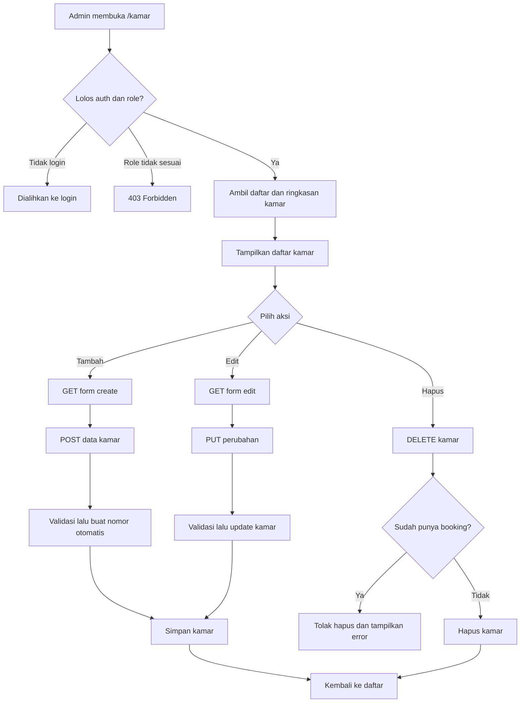

# Panduan Belajar: Pengelolaan Kamar

Fitur pengelolaan kamar menyediakan CRUD inventaris untuk admin dan super admin. Admin dapat melihat daftar serta ringkasan kamar, menambahkan kamar dengan nomor otomatis, mengubah informasi kamar, dan menghapus kamar yang belum memiliki riwayat pemesanan.

## 1. Alur Kerja



**Rincian alur:**

- Semua route resource kamar kecuali `show` dibatasi middleware `auth` dan `role:admin,super_admin`.
- Halaman daftar mengambil kamar terbaru dengan pagination 10 item, serta menghitung total kamar, kamar tersedia, dan kamar terisi.
- Form tambah dan edit memakai partial field yang sama. Saat create, server menentukan `nomor_kamar`; field ini tidak dapat dimasukkan atau diubah lewat form.
- Controller memvalidasi tipe, harga, kapasitas, status, dan deskripsi sebelum create/update.
- Penghapusan ditolak jika kamar memiliki booking apa pun, termasuk booking yang sudah dibatalkan atau selesai.

## 2. File Terkait

| File | Peran |
|---|---|
| [`web.php`](../../routes/web.php) | Mendaftarkan resource kamar dan membatasi seluruh route-nya ke admin/super admin. |
| [`KamarController.php`](../../app/Http/Controllers/KamarController.php) | Mengelola daftar, ringkasan, form, validasi CRUD, nomor otomatis, dan aturan penghapusan. |
| [`Kamar.php`](../../app/Models/Kamar.php) | Model kamar, field yang dapat diisi, relasi booking, scope ketersediaan, dan label status. |
| [`index.blade.php`](../../resources/views/kamar/index.blade.php) | Menampilkan ringkasan, kartu kamar, aksi edit/hapus, dan empty state. |
| [`create.blade.php`](../../resources/views/kamar/create.blade.php) | Form tambah kamar dan informasi bahwa nomor kamar dibuat otomatis. |
| [`edit.blade.php`](../../resources/views/kamar/edit.blade.php) | Form edit kamar; identitas nomor kamar ditampilkan tetapi tidak dapat diubah. |
| [`_fields.blade.php`](../../resources/views/kamar/_fields.blade.php) | Partial field bersama untuk tipe, harga, status, kapasitas, dan deskripsi. |
| [`_form_styles.blade.php`](../../resources/views/kamar/_form_styles.blade.php) | Styling yang dipakai form create dan edit. |
| [`anavbar.blade.php`](../../resources/views/components/anavbar.blade.php) | Navigasi operasional untuk mencapai menu kamar. |
| [`create_kamars_table`](../../database/migrations/2026_11_26_070044_create_kamars_table.php) | Membuat tabel kamar, unique nomor, harga, kapasitas, status, dan deskripsi. |
| [`add_cleaning_to_kamars_status_enum`](../../database/migrations/2026_11_26_193000_add_cleaning_to_kamars_status_enum.php) | Menambahkan status `cleaning` ke daftar status kamar di database. |
| [`create_bookings_table`](../../database/migrations/2026_11_27_110000_create_bookings_table.php) | Menetapkan foreign key kamar dengan `restrictOnDelete`. |

## 3. Bedah Kode Inti

### Proteksi route dan resource CRUD

Di `routes/web.php`, route kamar ditempatkan pada grup role:

```php
Route::middleware(['auth', 'role:admin,super_admin'])->group(function () {
    Route::resource('kamar', KamarController::class)->except(['show']);
});
```

Resource menghasilkan route daftar, create, store, edit, update, dan destroy. `show` dikecualikan karena halaman detail kamar publik ditangani oleh `BookingController`, bukan halaman detail admin.

### Validasi data sebelum create/update

Controller memakai aturan yang sama pada `store` dan `update`:

```php
'tipe_kamar' => 'required|in:Standar,Deluxe,Suite',
'harga_per_malam' => 'required|numeric|min:0',
'kapasitas' => 'required|integer|min:1',
'status' => 'required|in:tersedia,terisi,cleaning,maintenance',
'deskripsi' => 'nullable|string',
```

Validasi server menjaga nilai tetap berada di pilihan yang didukung. Field `nomor_kamar` tidak berasal dari request; model mengizinkan field inventaris melalui `$fillable`, tetapi Controller hanya meneruskan data yang sudah divalidasi ditambah nomor otomatis.

### Penomoran otomatis

Potongan dari `KamarController::store`:

```php
$nomorKamarTerbesar = Kamar::query()
    ->pluck('nomor_kamar')
    ->filter(fn ($nomor) => ctype_digit((string) $nomor))
    ->map(fn ($nomor) => (int) $nomor)
    ->max() ?? 0;

$dataKamar['nomor_kamar'] = (string) ($nomorKamarTerbesar + 1);
```

Controller mengambil semua nomor yang hanya berisi digit, mengubahnya ke integer, mencari nilai maksimum, lalu menambah satu. Nomor non-numerik tidak dipakai dalam perhitungan. Kolom `nomor_kamar` juga memiliki constraint unik di database sebagai perlindungan terhadap duplikasi.

### Penghapusan dengan pemeriksaan relasi

Potongan dari `KamarController::destroy`:

```php
if ($kamar->bookings()->exists()) {
    return redirect()->route('kamar.index', ['tab' => 'kamar'])
        ->with('error', 'Kamar memiliki riwayat pemesanan dan tidak dapat dihapus.');
}

$kamar->delete();
```

`bookings()` adalah relasi `hasMany` di model `Kamar`. Pemeriksaan `exists()` menghentikan penghapusan bila ada satu saja booking terkait, tanpa membedakan status booking. Migration booking juga mendefinisikan foreign key kamar dengan `restrictOnDelete`, sehingga database ikut mencegah penghapusan kamar yang masih direferensikan.

**Edge case dan batasan:**

- Input tipe, harga, kapasitas, atau status yang tidak valid ditolak; harga tidak boleh negatif dan kapasitas minimal satu.
- Jika URL mengarah ke kamar yang tidak ditemukan, route model binding menghasilkan 404.
- Nomor non-numerik diabaikan saat menentukan nomor berikutnya. Jika tidak ada nomor numerik, penomoran dimulai dari `1`.
- Nomor dibuat dengan membaca maksimum lalu menambah satu, tanpa transaksi atau lock khusus. Dua create bersamaan berpotensi memilih nomor sama; constraint unik database akan menolak salah satunya.
- Kamar dengan booking apa pun tidak bisa dihapus. Mengubah status atau kapasitas kamar tetap dapat dilakukan meskipun kamar sudah memiliki booking; Controller tidak memeriksa dampak perubahan itu terhadap booking lama.
- Ringkasan `occupied` hanya menghitung status `terisi`; status `cleaning` dan `maintenance` tidak termasuk hitungan tersedia maupun terisi.

## 4. Poin Pembelajaran

- **Resource controller:** route resource menghubungkan aksi CRUD ke method controller dengan pola HTTP yang konsisten.
- **Validasi sebelum persistensi:** hanya data yang sudah lolos aturan bisnis yang diteruskan ke `create` atau `update`.
- **Nomor identitas buatan server:** field yang menentukan identitas kamar tidak diserahkan kepada input klien.
- **Relasi Eloquent:** `hasMany` memungkinkan pemeriksaan apakah kamar memiliki booking terkait.
- **Constraint database sebagai lapisan tambahan:** unique constraint dan foreign key melindungi integritas data selain pemeriksaan aplikasi.
- **Pagination dan agregasi:** `paginate(10)` membatasi daftar, sementara `count()` menyusun ringkasan tanpa memuat seluruh data.
- **Status adalah state operasional:** tersedia, terisi, cleaning, dan maintenance memiliki arti berbeda dan tidak otomatis diturunkan dari booking.
- **Race condition penomoran:** pola baca-maksimum-lalu-tambah sederhana, tetapi membutuhkan strategi sinkronisasi tambahan jika create kamar dapat terjadi serentak.
