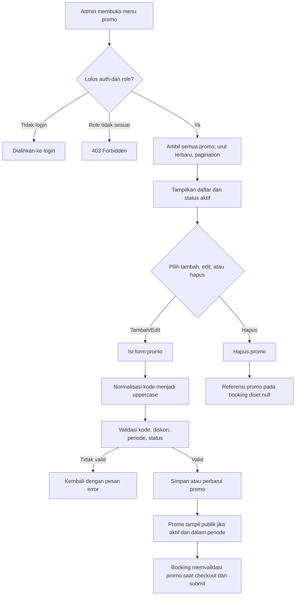

# Panduan Belajar: Pengelolaan Promo Admin

Fitur ini memungkinkan admin mengelola kode promo, persentase diskon, deskripsi, masa berlaku, dan status aktif. Promo yang aktif dan berada dalam tanggal berlakunya dapat ditampilkan kepada pengunjung dan dipakai saat checkout.

## 1. Alur Kerja



**Rincian alur:**

- Daftar admin memuat semua promo—aktif, nonaktif, belum mulai, maupun kedaluwarsa—dan memaginasi 12 item per halaman.
- Saat create/update, controller trim spasi dan mengubah kode menjadi huruf kapital sebelum validasi serta penyimpanan.
- Promo aktif ditentukan oleh dua hal: flag `aktif` bernilai true dan tanggal hari ini berada di antara tanggal mulai dan akhir, termasuk kedua batas tanggal.
- Form admin menggunakan `POST` untuk create, `PUT` untuk update, dan `DELETE` untuk penghapusan.
- Saat promo dihapus, foreign key `promo_id` pada booking menjadi `null`; kolom `promo_code` dan `discount_amount` pada booking tetap tersedia sebagai catatan.
- Checkout memeriksa promo aktif lagi sebelum booking dibuat, jadi promo yang nonaktif atau kedaluwarsa tidak bisa dipakai.

## 2. File Terkait

| File | Peran |
|---|---|
| [`web.php`](../../routes/web.php) | Mendaftarkan daftar promo admin dan resource create/update/delete di grup admin yang terlindungi. |
| [`PromoController.php`](../../app/Http/Controllers/PromoController.php) | Menangani daftar admin, CRUD, normalisasi kode, serta daftar promo publik. |
| [`Promo.php`](../../app/Models/Promo.php) | Model promo dengan scope aktif, cast atribut, relasi booking, dan perhitungan diskon. |
| [`BookingController.php`](../../app/Http/Controllers/BookingController.php) | Memvalidasi promo saat checkout dan mengecek ulang ketika menyimpan pemesanan. |
| [`Booking.php`](../../app/Models/Booking.php) | Menyimpan referensi promo, kode promo, serta nominal diskon di data booking. |
| [`index.blade.php` admin](../../resources/views/admin/promos/index.blade.php) | Menampilkan daftar promo, indikator aktif, edit/hapus, dan pagination. |
| [`form.blade.php`](../../resources/views/admin/promos/form.blade.php) | Form tambah/edit promo dan tampilan error validasi. |
| [`index.blade.php` publik](../../resources/views/promo/index.blade.php) | Menampilkan promo yang aktif untuk pengunjung. |
| [`create.blade.php` checkout](../../resources/views/booking/create.blade.php) | Memungkinkan pelanggan memasukkan kode promo dan melihat estimasi diskon. |
| [`RoleMiddleware.php`](../../app/Http/Middleware/RoleMiddleware.php) | Membatasi akses pengelolaan promo untuk admin dan super admin. |
| [`create_promos_table`](../../database/migrations/2026_11_27_103000_create_promos_table.php) | Membuat tabel promo dan unique constraint untuk kolom kode. |
| [`add_promo_to_bookings_table`](../../database/migrations/2026_11_27_120000_add_promo_to_bookings_table.php) | Menambahkan foreign key promo yang nullable dan diset null saat promo dihapus. |

## 3. Bedah Kode Inti

### Proteksi route admin

Route daftar khusus admin dan aksi resource berada di grup `auth` serta role:

```php
Route::middleware(['auth', 'role:admin,super_admin'])->prefix('admin')->name('admin.')->group(function () {
    Route::get('/promos', [PromoController::class, 'adminIndex'])->name('promos.index');
    Route::resource('promos', PromoController::class)->except(['index', 'show']);
});
```

Daftar ditangani `adminIndex()` secara eksplisit; resource menyediakan aksi create, store, edit, update, dan destroy. Route publik untuk daftar promo berada terpisah dan hanya menampilkan data aktif.

### Normalisasi kode dan validasi

Potongan dari `PromoController::store`:

```php
$request->merge(['kode' => Str::upper(trim((string) $request->input('kode')))]);

$data = $request->validate([
    'judul' => 'required|string|max:120',
    'kode' => 'required|string|max:30|unique:promos,kode',
    'diskon_persen' => 'required|numeric|min:0.01|max:100',
    'mulai_pada' => 'required|date_format:Y-m-d',
    'berakhir_pada' => 'required|date_format:Y-m-d|after_or_equal:mulai_pada',
    'aktif' => 'required|boolean',
]);
```

Normalisasi sebelum validasi membuat kode yang disimpan konsisten. Persentase diskon harus lebih dari nol sampai maksimal 100; tanggal akhir boleh sama dengan tanggal mulai. `update()` menggunakan aturan serupa tetapi `Rule::unique(...)->ignore($promo->id)`, sehingga kode promo dapat dipertahankan saat mengedit promo yang sama tanpa dianggap duplikat.

### Menentukan promo aktif dan menghitung diskon

Scope di `Promo.php`:

```php
return $query->where('aktif', true)
    ->whereDate('mulai_pada', '<=', $date)
    ->whereDate('berakhir_pada', '>=', $date);
```

Scope ini digunakan oleh daftar publik dan pencarian kode promo saat checkout. Diskon nominal dihitung oleh model:

```php
return round($amount * (float) $this->diskon_persen / 100, 2);
```

Karena batas tanggal inklusif, promo berlaku pada hari mulai dan hari berakhir jika flag `aktif` juga true. Kode yang dimasukkan pelanggan dinormalisasi lagi pada `BookingController`, lalu diperiksa saat preview checkout dan diperiksa ulang dalam transaksi saat booking disimpan.

### Checkbox status dan dampak penghapusan

Form admin mengirim nilai eksplisit untuk checkbox:

```blade
<input type="hidden" name="aktif" value="0">
<input type="checkbox" id="aktif" name="aktif" value="1"
    @checked(old('aktif', $promo->aktif ?? true))>
```

Nilai tersembunyi mengirim `0` saat checkbox tidak dicentang; nilai `1` digunakan saat dicentang. Pada promo baru, pilihan awalnya aktif. Jika promo dihapus, constraint `nullOnDelete` pada `promo_id` melepaskan relasi booking tanpa menghapus booking tersebut; kolom kode dan nominal diskon booking tetap menyimpan jejak promo yang digunakan.

**Edge case dan batasan:**

- Kode kosong, kode duplikat, diskon di luar rentang, tanggal tidak valid, atau tanggal akhir sebelum tanggal mulai ditolak validasi.
- Saat update, kode yang sama milik promo itu sendiri diperbolehkan; kode milik promo lain tetap ditolak.
- Checkbox yang tidak dicentang tetap menghasilkan nilai `aktif = 0`, bukan field yang hilang.
- Promo dengan flag aktif tetapi tanggalnya di masa depan atau sudah lewat tidak lolos scope `active`.
- Kode promo yang berubah status atau kedaluwarsa setelah checkout ditampilkan akan divalidasi ulang saat submit; booking gagal dibuat jika promo tidak lagi aktif.
- Penghapusan promo tidak menghapus booking terkait. `promo_id` menjadi null, sedangkan kode dan nilai diskon tersimpan di booking.

## 4. Poin Pembelajaran

- **Normalisasi input sebelum validasi:** trim dan uppercase mengurangi variasi format kode yang sama.
- **Unique validation saat update:** pengecualian ID saat edit mencegah record menganggap dirinya sendiri sebagai duplikat.
- **Query scope model:** aturan aktif tersentralisasi dan digunakan kembali di halaman publik serta alur checkout.
- **Tanggal inklusif:** penggunaan `<=` dan `>=` membuat promo berlaku pada tanggal mulai dan tanggal akhir.
- **Checkbox HTML:** hidden input mengatasi perilaku checkbox yang tidak mengirim nilai saat tidak dicentang.
- **Referential integrity:** `nullOnDelete` mempertahankan booking historis sambil melepaskan relasi promo yang dihapus.
- **Validasi ulang saat transaksi:** status promo dapat berubah antara preview dan submit, jadi server memeriksanya lagi sebelum menyimpan booking.
- **Pemisahan data admin dan publik:** admin melihat seluruh promo untuk mengelolanya, sementara pengunjung hanya mendapat promo aktif.
