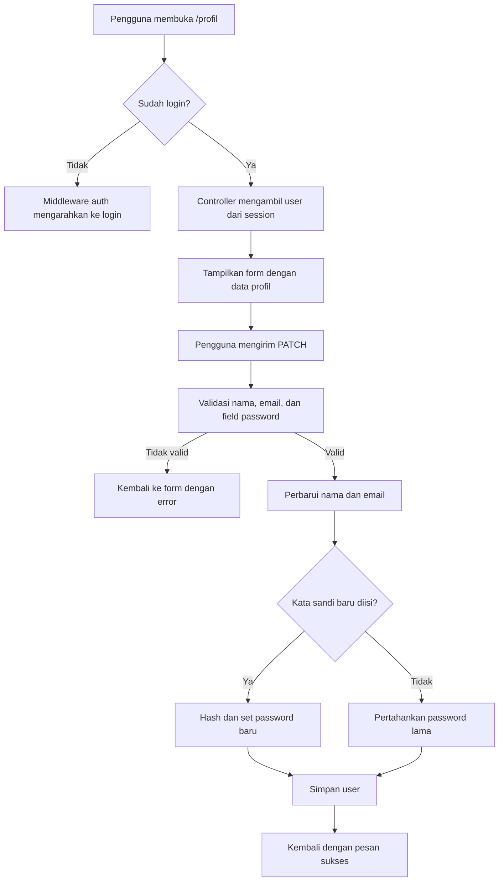

# Panduan Belajar: Profil Pelanggan

Fitur profil memungkinkan pengguna yang sudah login melihat dan memperbarui nama serta email akun. Pengguna juga dapat mengganti kata sandi dengan memasukkan kata sandi saat ini dan konfirmasi kata sandi baru.

## 1. Alur Kerja



**Rincian alur:**

- Route `GET /profil` mengambil user yang sedang login dari request dan mengirimkannya ke view.
- Form mengirim `PATCH` dengan nama dan email wajib; penggantian password opsional.
- Jika password baru akan diganti, kata sandi saat ini wajib benar dan password baru harus memenuhi panjang minimal serta konfirmasi.
- Setelah validasi, Controller mengubah hanya atribut milik akun aktif, menyimpan model, lalu kembali dengan pesan sukses.

## 2. File Terkait

| File | Peran |
|---|---|
| [`web.php`](../../routes/web.php) | Mendaftarkan route `profile.edit` dan `profile.update` di dalam grup middleware `auth`. |
| [`ProfileController.php`](../../app/Http/Controllers/ProfileController.php) | Mengambil user saat ini dan memvalidasi serta menyimpan pembaruan profil. |
| [`User.php`](../../app/Models/User.php) | Model akun, menyembunyikan password/token dari serialisasi, dan memiliki cast password `hashed`. |
| [`edit.blade.php`](../../resources/views/profile/edit.blade.php) | Form nama/email, input password opsional, CSRF, method spoofing PATCH, dan pesan validasi. |
| [`create_users_table`](../../database/migrations/0001_01_01_000000_create_users_table.php) | Mendefinisikan kolom nama, email unik, password, dan role pengguna. |

## 3. Bedah Kode Inti

### Mengambil akun dari sesi, bukan dari parameter URL

Potongan dari `ProfileController::edit`:

```php
public function edit(Request $request)
{
    return view('profile.edit', ['user' => $request->user()]);
}
```

Controller memakai user terautentikasi dari request. Route tidak menerima `user_id` untuk dipilih, sehingga halaman profil bekerja pada akun yang sedang login, bukan akun arbitrer.

### Validasi email unik dan pembaruan password bersyarat

Potongan validasi dari `ProfileController::update`:

```php
'email' => ['required', 'email', 'max:255', Rule::unique('users', 'email')->ignore($user->id)],
'current_password' => 'nullable|required_with:new_password|current_password',
'new_password' => 'nullable|required_with:current_password|string|min:8|confirmed',
```

Aturan unique mengecualikan ID user saat ini agar email yang tidak berubah tidak dianggap duplikat. `required_with` menghubungkan dua field password: bila password baru diisi, password saat ini wajib diisi dan lolos rule `current_password`; bila password saat ini diisi, password baru juga diwajibkan. Untuk tidak mengganti password, keduanya harus dibiarkan kosong. Rule `confirmed` mencocokkan `new_password` dengan field `new_password_confirmation`.

### Simpan hanya perubahan yang relevan

Potongan dari `ProfileController::update`:

```php
$user->name = $data['name'];
$user->email = $data['email'];

if (! empty($data['new_password'])) {
    $user->password = Hash::make($data['new_password']);
}

$user->save();
```

Controller tidak melakukan mass assignment terhadap seluruh request. Hanya nama, email, dan—jika diminta—password yang diperbarui; role tidak diubah oleh form profil. Password baru di-hash sebelum disimpan, dan model `User` juga mendefinisikan cast `hashed`.

Form view menggunakan `@csrf` dan `@method('PATCH')` karena HTML form standar tidak mengirim method PATCH secara langsung. Jika validasi gagal, Laravel kembali ke form dengan error; field teks memakai `old()` untuk mempertahankan input, sedangkan password tetap kosong.

**Edge case dan batasan:**

- Email yang tidak valid atau digunakan akun lain ditolak; email milik akun sendiri tetap boleh dipertahankan.
- Password baru tanpa password saat ini gagal validasi; password saat ini tanpa password baru juga gagal karena pasangan field diwajibkan bersama.
- Password baru harus minimal 8 karakter dan cocok dengan konfirmasi.
- Field kosong untuk kedua password berarti password lama tidak diubah.
- Route dilindungi `auth`; guest tidak dapat melihat atau memperbarui profil.
- Controller tidak mengubah role. Walaupun `role` termasuk `$fillable` di model `User`, form profil dan Controller tidak memasukkan role ke data yang disimpan.
- Controller tidak mengatur ulang `email_verified_at` atau mengirim proses verifikasi ulang ketika email berubah; alur verifikasi email tidak ditangani fitur ini.

## 4. Poin Pembelajaran

- **Identitas berasal dari autentikasi:** gunakan `$request->user()` untuk membatasi perubahan ke akun aktif, bukan mempercayai ID dari klien.
- **Validasi unik saat edit:** `Rule::unique()->ignore($user->id)` menangani kasus memperbarui record yang emailnya tidak berubah.
- **Validasi field yang saling bergantung:** `required_with` dan `confirmed` mengatur alur pergantian password tanpa membuat password wajib setiap kali profil disimpan.
- **Mass assignment terkontrol:** menetapkan atribut satu per satu mencegah field request yang tidak relevan ikut tersimpan.
- **Password harus di-hash:** aplikasi tidak menyimpan password baru sebagai teks biasa.
- **Method spoofing dan CSRF:** form Laravel menggunakan token CSRF dan `@method('PATCH')` untuk mengirim operasi update.
- **Pisahkan pengalaman form dari aturan server:** `old()` dan pesan error membantu pengguna memperbaiki input, tetapi validasi tetap dilakukan di Controller.
- **Perubahan email dan verifikasi:** memperbarui alamat email dapat memerlukan kebijakan verifikasi ulang yang perlu ditangani secara eksplisit bila fitur tersebut diaktifkan.
