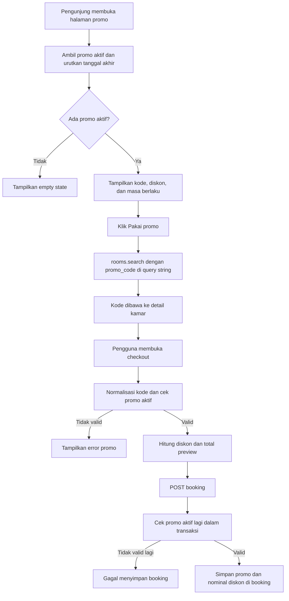

# Panduan Belajar: Promo Publik dan Penggunaan Kode

Pengunjung dapat melihat daftar promo yang sedang berlaku. Saat mencari kamar, kode promo dapat dibawa ke detail kamar dan dimasukkan atau diterapkan pada checkout. Kode yang valid mengurangi subtotal berdasarkan persentase diskon; promo diperiksa lagi saat booking dikirim.

## 1. Alur Kerja



**Rincian alur:**

- Halaman promo publik hanya menampilkan promo yang flag `aktif`-nya true dan tanggal hari ini masih dalam periode promo.
- Tombol “Pakai promo” mengirim kode ke pencarian kamar sebagai `promo_code`. Tahap pencarian hanya membawa kode tersebut—tidak memfilter kamar atau menerapkan diskon.
- Kode diteruskan ke detail kamar dan checkout. Checkout memeriksa kode, menghitung subtotal dari harga kamar dan jumlah malam, lalu mengurangi diskon.
- Saat pelanggan mengirim pemesanan, server memvalidasi ulang promo dan menghitung ulang jumlah diskon di dalam transaksi. Booking mencatat referensi promo, kode, dan nilai diskon.
- Satu kode promo dapat digunakan per pemesanan; fitur tidak menggabungkan beberapa promo.

## 2. File Terkait

| File | Peran |
|---|---|
| [`web.php`](../../routes/web.php) | Mendaftarkan route promo publik dan route pencarian, detail kamar, serta checkout. |
| [`PromoController.php`](../../app/Http/Controllers/PromoController.php) | Memilih promo aktif untuk halaman publik. |
| [`BookingController.php`](../../app/Http/Controllers/BookingController.php) | Meneruskan filter promo, memvalidasi kode saat checkout, menghitung ulang diskon, dan menyimpan data promo di booking. |
| [`Promo.php`](../../app/Models/Promo.php) | Scope `active`, cast tanggal/status, relasi booking, dan helper hitung diskon. |
| [`Booking.php`](../../app/Models/Booking.php) | Menyimpan `promo_id`, `promo_code`, dan `discount_amount` dalam data pemesanan. |
| [`index.blade.php` promo publik](../../resources/views/promo/index.blade.php) | Menampilkan promo aktif, kode, diskon, tanggal akhir, dan tombol “Pakai promo”. |
| [`dashboard.blade.php`](../../resources/views/dashboard.blade.php) | Menampilkan hingga dua promo aktif pada banner beranda. |
| [`search.blade.php`](../../resources/views/booking/search.blade.php) | Menyimpan kode promo di filter pencarian dan meneruskannya ke detail kamar. |
| [`room.blade.php`](../../resources/views/booking/room.blade.php) | Meneruskan kode dari detail kamar ke route checkout. |
| [`create.blade.php` checkout](../../resources/views/booking/create.blade.php) | Form kode promo dan ringkasan subtotal, potongan, serta total. |
| [`create_promos_table`](../../database/migrations/2026_11_27_103000_create_promos_table.php) | Membuat tabel promo, termasuk kode unik, persen diskon, periode, dan flag aktif. |
| [`add_promo_to_bookings_table`](../../database/migrations/2026_11_27_120000_add_promo_to_bookings_table.php) | Menyimpan referensi/kode promo dan nominal diskon pada tabel booking. |

## 3. Bedah Kode Inti

### Menentukan promo yang tampil ke pengunjung

`PromoController::index` menjalankan:

```php
$promos = Promo::query()
    ->active()
    ->orderBy('berakhir_pada')
    ->get();
```

Scope `active` di model menerapkan flag aktif dan periode tanggal:

```php
return $query->where('aktif', true)
    ->whereDate('mulai_pada', '<=', $date)
    ->whereDate('berakhir_pada', '>=', $date);
```

Tanggal awal dan akhir bersifat inklusif. Halaman promo publik menampilkan semua hasil scope ini, sedangkan banner beranda memilih maksimal dua promo aktif yang paling cepat berakhir.

### Kode promo dibawa sebagai filter, bukan langsung diterapkan

Tombol publik membangun tautan ke pencarian dengan `promo_code`. `BookingController::search` memvalidasi bahwa kode opsional berupa string dengan batas panjang, lalu meneruskan `filters` ke view. Pencarian tidak memeriksa apakah kode aktif dan tidak mengubah harga kamar. Validasi serta kalkulasi promo baru dilakukan pada checkout.

### Menghitung diskon saat checkout

Pada `BookingController::create`, kode dinormalisasi dan dicari hanya di antara promo aktif:

```php
$promoCode = Str::upper(trim($filters['promo_code'] ?? ''));
$promo = $promoCode ? $this->activePromo($promoCode) : null;

if ($promoCode && ! $promo) {
    throw ValidationException::withMessages([
        'promo_code' => 'Kode promo tidak aktif atau tidak ditemukan.',
    ]);
}
```

Jika valid, controller menghitung jumlah malam dan subtotal lalu meminta model menghitung potongan:

```php
$subtotal = (float) $kamar->harga_per_malam * $nights;
$discountAmount = $promo?->discountFor($subtotal) ?? 0;
$totalAmount = $subtotal - $discountAmount;
```

`Promo::discountFor()` menghitung persentase dari subtotal dan membulatkan hasil ke dua angka desimal. Tanpa kode promo, `$promo` bernilai `null` dan potongan menjadi nol.

### Pemeriksaan ulang saat menyimpan

Kode yang tampil pada preview bukan bukti promo masih berlaku. Dalam `BookingController::store`, kode dinormalisasi lagi, kemudian promo aktif dicari kembali dalam transaksi (dengan row lock). Jika promo sudah nonaktif/kedaluwarsa, controller melempar error dan booking tidak dibuat. Jika valid, booking menyimpan `promo_id`, kode promo, diskon, dan total hasil kalkulasi server—bukan nilai dari browser.

**Edge case dan batasan:**

- Jika tidak ada promo aktif, halaman publik menampilkan empty state dan banner beranda disembunyikan.
- Promo dengan tanggal mulai di masa depan, tanggal akhir yang sudah lewat, atau flag nonaktif tidak lolos scope `active`.
- Kode yang kosong berarti tanpa diskon; kode tidak dikenal atau tidak aktif ditolak saat checkout.
- Kode dapat dibawa melalui pencarian tanpa validasi status promo; validasi baru terjadi ketika checkout dibuka.
- Jika admin menonaktifkan atau mengubah tanggal promo setelah preview, pemeriksaan ulang saat submit dapat menolak booking.
- Diskon dibatasi oleh konfigurasi promo admin (lebih dari 0 sampai 100 persen). Tidak ada minimum transaksi atau stacking beberapa kode pada alur ini.
- Pembulatan nominal potongan dilakukan sampai dua angka desimal; tampilan mata uang view umumnya membulatkan presentasi ke Rupiah utuh.

## 4. Poin Pembelajaran

- **Scope query yang dapat digunakan ulang:** aturan promo aktif dipusatkan di model dan digunakan oleh daftar publik serta checkout.
- **Perbedaan membawa filter dan menerapkan aturan bisnis:** query string hanya membawa kode; keputusan apakah promo berlaku dilakukan server pada checkout.
- **Normalisasi input:** `trim` dan uppercase membuat pencarian kode konsisten dengan format yang disimpan.
- **Kalkulasi di server:** harga, durasi, diskon, dan total tidak diambil dari input klien.
- **Validasi ulang pada operasi tulis:** status promo dapat berubah antara preview dan submit, jadi server memeriksanya lagi sebelum membuat booking.
- **Decimal dan pembulatan:** persentase diskon dihitung dari subtotal dan dibulatkan dengan presisi uang.
- **Snapshot untuk riwayat:** booking menyimpan kode dan nominal diskon yang digunakan, selain foreign key promo.
- **Empty state:** halaman publik tetap memberi informasi ketika tidak ada promo yang berlaku.
