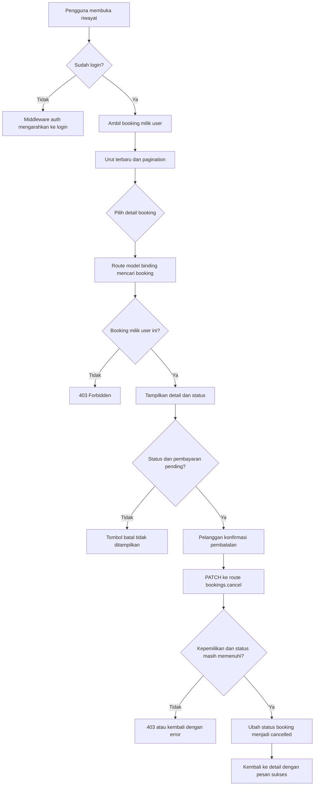

# Panduan Belajar: Riwayat dan Pembatalan Pemesanan

Pelanggan yang sudah login dapat melihat daftar dan detail booking miliknya. Pembatalan mandiri hanya diizinkan saat status booking dan status pembayaran sama-sama `pending`.

## 1. Alur Kerja



**Rincian alur:**

- Route riwayat, detail, dan pembatalan semuanya berada di grup middleware `auth`.
- Daftar mengambil booking melalui relasi user yang sedang login, mengurutkan dari yang terbaru, lalu menampilkan 10 item per halaman.
- Saat membuka detail, Controller memeriksa `user_id` booking cocok dengan ID pengguna aktif. Pengguna tidak dapat melihat detail booking orang lain.
- Tombol batal muncul hanya jika booking dan pembayaran sama-sama `pending`. Controller mengulangi pemeriksaan kepemilikan dan status saat menerima request.
- Pembatalan hanya mengubah status booking menjadi `cancelled`; status pembayaran tidak diubah.

## 2. File Terkait

| File | Peran |
|---|---|
| [`web.php`](../../routes/web.php) | Mendaftarkan route riwayat, detail, dan pembatalan dalam grup middleware `auth`. |
| [`BookingController.php`](../../app/Http/Controllers/BookingController.php) | Mengambil riwayat milik pengguna, mengotorisasi detail, dan memproses pembatalan. |
| [`Booking.php`](../../app/Models/Booking.php) | Model booking, cast tanggal/biaya, dan relasi ke user serta kamar. |
| [`User.php`](../../app/Models/User.php) | Menyediakan relasi `bookings()` yang dipakai untuk membatasi riwayat ke pemilik akun. |
| [`index.blade.php`](../../resources/views/booking/index.blade.php) | Menampilkan daftar ringkas booking, empty state, dan pagination. |
| [`show.blade.php`](../../resources/views/booking/show.blade.php) | Menampilkan detail booking, status pembayaran, instruksi pembayaran, dan tombol batal bersyarat. |
| [`unavbar.blade.php`](../../resources/views/components/unavbar.blade.php) | Menyediakan tautan “Pemesanan saya” bagi pengguna yang login. |
| [`create_bookings_table`](../../database/migrations/2026_11_27_110000_create_bookings_table.php) | Mendefinisikan kolom status booking dan status pembayaran. |

## 3. Bedah Kode Inti

### Riwayat hanya dari relasi pengguna aktif

Potongan dari `BookingController::index`:

```php
$bookings = $request->user()
    ->bookings()
    ->with('kamar')
    ->latest()
    ->paginate(10);
```

Query dimulai dari `$request->user()->bookings()`, sehingga hasil hanya berisi booking pemilik akun. `with('kamar')` memuat relasi yang dibaca di daftar tanpa query kamar per booking. `latest()` mengurutkan berdasarkan waktu pembuatan terbaru; pagination membatasi 10 record per halaman. Jika belum ada hasil, view menampilkan ajakan untuk mencari kamar.

### Otorisasi saat membuka detail

Potongan dari `BookingController::show`:

```php
abort_unless($booking->user_id === $request->user()->id, 403);

$booking->load('kamar');
return view('booking.show', compact('booking'));
```

Route model binding menemukan booking dari parameter URL, tetapi menemukan record tidak berarti pengguna berhak melihatnya. Pemeriksaan eksplisit memastikan pemilik booking sama dengan pengguna aktif; jika berbeda, request dihentikan dengan 403.

### Pembatalan memeriksa kepemilikan dan status

Potongan dari `BookingController::cancel`:

```php
abort_unless($booking->user_id === $request->user()->id, 403);

if ($booking->status !== 'pending' || $booking->payment_status !== 'pending') {
    return back()->with('error', 'Pemesanan ini tidak dapat dibatalkan dari akun Anda.');
}

$booking->update(['status' => 'cancelled']);
```

Kedua syarat harus dipenuhi: status pemesanan `pending` **dan** status pembayaran `pending`. Operator `||` membuat pembatalan ditolak jika salah satu kondisi tidak sesuai. Jika lolos, hanya `status` booking yang diubah. View menerapkan kondisi serupa untuk menyembunyikan tombol, tetapi keputusan final tetap di Controller.

**Edge case dan batasan:**

- Guest yang membuka riwayat, detail, atau endpoint pembatalan diarahkan ke login oleh middleware `auth`.
- Booking dengan ID tidak dikenal menghasilkan 404 dari route model binding; booking milik pengguna lain menghasilkan 403.
- Booking yang sudah `confirmed`, `completed`, atau `cancelled`, maupun booking dengan pembayaran `paid`, tidak dapat dibatalkan mandiri.
- Request batal yang tidak memenuhi syarat kembali ke halaman sebelumnya dengan pesan error, meskipun tombol batal mungkin tidak ditampilkan di view.
- Pembatalan tidak menghapus booking atau mengubah status pembayaran; riwayat tetap tersimpan.
- Pada halaman detail, judul status menampilkan “Dibatalkan” untuk `cancelled` dan “Dikonfirmasi” untuk `confirmed`; status lain memakai judul fallback “Menunggu konfirmasi”. Karena itu booking `completed` masih mendapat judul fallback tersebut walau status rinci di bawahnya menampilkan nilai sebenarnya.
- Daftar riwayat tidak menyediakan filter status; daftar hanya diurutkan dan dipaginasi.

## 4. Poin Pembelajaran

- **Otorisasi berbasis kepemilikan:** status login saja tidak cukup; setiap booking harus diperiksa apakah milik pengguna yang meminta.
- **Relasi Eloquent untuk scoping data:** memulai query dari `$user->bookings()` secara alami membatasi daftar ke pemiliknya.
- **Route model binding bukan otorisasi:** binding mengambil objek berdasarkan ID, sedangkan pemeriksaan kepemilikan tetap harus dilakukan eksplisit.
- **Pertahanan berlapis:** menyembunyikan tombol di Blade meningkatkan UX, tetapi Controller tetap memvalidasi hak dan kondisi saat request diterima.
- **Transisi status bisnis:** pembatalan mempertahankan record dan hanya mengubah state, bukan menghapus data historis.
- **Perbedaan status booking dan pembayaran:** keduanya dipakai bersama sebagai syarat pembatalan, tetapi pembatalan tidak otomatis mengubah status pembayaran.
- **Eager loading dan pagination:** `with()` membantu menghindari N+1 query dan `paginate()` menjaga ukuran hasil tetap terbatas.
